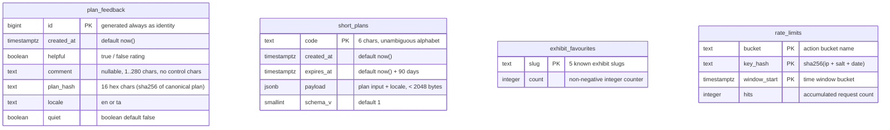

# Data Model Specification — Northside Discovery Centre

---

## 1. Entity Relationship Diagram

*Note: There are deliberately **no foreign keys** between tables. No row can be traced to an individual visitor, IP address, or joined to external profile records.*

---

## 2. Table Specifications & Database Constraints

1. `public.plan_feedback`:
   - `id`: Bigint primary key identity.
   - `comment`: Constrained to `null or length between 1 and 280`. Comments are internal only and never rendered on client pages.
   - `plan_hash`: Checked against `^[a-f0-9]{16}$`.
   - `locale`: Constrained to `'en'` or `'ta'`.
2. `public.short_plans`:
   - `code`: Checked against unambiguous 31-character alphabet `^[a-hjkmnp-z2-9]{6}$` (omits `i`, `l`, `o`, `0`, `1`).
   - `payload`: Valid JSON object constrained to `< 2048` bytes.
   - `expires_at`: Indexed for automatic 90-day expiration cleanup.
3. `public.exhibit_favourites`:
   - `slug`: Constrained strictly to known slugs (`light-lab`, `build-bench`, `sky-room`, `echo-tunnel`, `garden-trail`).
   - `count`: Guaranteed non-negative (`count >= 0`).
4. `public.rate_limits`:
   - Composite primary key `(bucket, key_hash, window_start)`.
   - Salted daily hashes prevent long-term tracking of IP addresses.

---

## 3. Row Level Security (RLS) & Permission Hardening

- All four tables have Row Level Security enabled (`ALTER TABLE ... ENABLE ROW LEVEL SECURITY`).
- **No policies exist** for `anon` or `authenticated` roles.
- `REVOKE ALL ON ALL TABLES/SEQUENCES IN SCHEMA public FROM anon, authenticated;`
- Direct SELECT, INSERT, UPDATE, or DELETE requests from the client return HTTP 401/403 errors.
- Access is strictly mediated through `SECURITY DEFINER` functions with fixed `search_path = ''`.

---

## 4. Failure & Degradation Matrix

| Condition | System Behaviour | User Impact |
|---|---|---|
| **Mode A (Supabase unset)** | Data store resolves to `OffDataStore`. Feedback summary returns `{ available: false }`; short links return fallback long URL; favourite counter hidden or default. | **Zero layout shift.** Core site, exhibits, ticket pricing, and planner run with 100% functionality. |
| **Supabase Outage / 5xx** | Request times out at 1.5 seconds via `AbortSignal.timeout(1500)` and maps to `StoreUnavailable`. | Planner and pages remain fully interactive. Friendly notice shown for short links ("Copied full link instead"). |
| **Rate Limit Exceeded (429)** | Server returns HTTP 429 with `Retry-After` header. | Clear, polite inline message ("Please wait a moment before trying again"). |
| **Client Network Disconnected** | Hand-written Service Worker serves cached application shell. Local Knapsack engine executes in browser. | Visitor can continue planning, explore exhibits, and view stored plans under `/offline`. |
