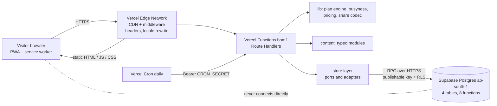
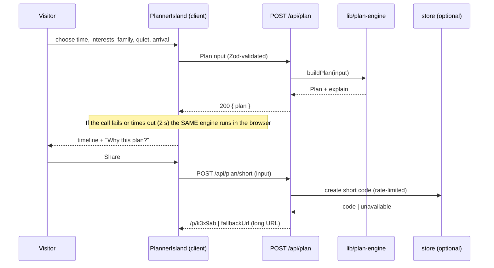
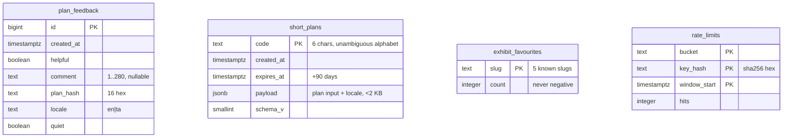

# PROMPT.md — Build the Northside Discovery Centre Website (Phase-wise, with Verification Gates)
## v2 · Vercel + Supabase edition · extended features · homepage architecture

> You are a senior full-stack engineer and product designer. Build the project below **one phase at a time**. Every phase ends with a **Verification Gate**. You may not start the next phase until the current gate passes with real evidence. Make decisions yourself rather than asking questions; when a detail is unspecified, choose the simplest, most accessible option that is easy to explain in an interview.

> **What changed in v2:** a full architecture (§2.6–2.8), nine extra features (§1.3), a Supabase data platform used *optionally and server-side only* (Phase 10), offline PWA (Phase 11), Tamil (Phase 12), a re-architected homepage (Phase 13), a public Quality page (Phase 14), and a Vercel + Supabase deployment runbook (Phase 15). **The brief in §1.1 and the fixed facts in §1.2 still win over everything else.**

---

## PART 0 — Execution Protocol (read first, obey always)

### 0.1 The loop for every phase
1. **Plan:** restate the phase goal in 2–3 lines.
2. **Build:** implement only what the phase lists. No work from later phases (small unavoidable stubs are fine).
3. **Gate:** run every check in the phase's Verification Gate. Run the commands for real and read their output.
4. **Report:** print a **Gate Report** (template below).
5. **Fix or advance:** if any check fails, fix the cause and re-run the whole gate. If all pass, commit and move on.

### 0.2 Gate rules
- **No evidence, no pass.** Never mark a check ✅ unless you ran it and saw it succeed. Quote the key line of output.
- **Never weaken the gate.** Do not delete, skip (`.skip`, `xit`), loosen, or rewrite a test or threshold to make it pass. Fix the code. If a gate item is truly wrong, say so explicitly in the report and propose the change instead of silently editing it.
- **Regression rule:** every gate also re-runs everything automated from earlier phases (`pnpm check` plus all e2e specs that exist so far). A previously passing check that now fails is a failure of the current phase.
- **Failure budget:** if the same gate item still fails after 3 genuine fix attempts, **stop**, print the Gate Report with the failing items, the likely root cause, and what you tried, and wait for the human.
- **Manual items** (marked 👁) cannot be fully automated. Produce the artifact (e.g. screenshots saved to `artifacts/phase-N/`) and list exactly what the human should look at. Do not claim a manual item passed.
- **Commit convention:** after a passing gate, commit with `phase N: <title>` and create the git tag `phase-N-pass`.

### 0.3 Gate Report template (print this at the end of every phase)

```
=== PHASE N GATE REPORT: <title> ===
| # | Check                          | Result | Evidence (key output line)   |
|---|--------------------------------|--------|------------------------------|
| 1 | <check>                        | ✅/❌  | <short quote or number>      |
Regression (earlier phases): ✅/❌  — <command + result>
Manual items for the human (👁): <list + file paths>
Fixes made during the gate: <list or "none">
Assumptions / deviations: <list or "none">
VERDICT: PASS → proceeding to Phase N+1   |   FAIL → <what is blocking>
```

### 0.4 Standard scripts (created in the phase noted, used by every gate after it)

| Script | Does | From |
|---|---|---|
| `pnpm dev` | Dev server on http://localhost:3000 | P0 |
| `pnpm lint` | ESLint, zero warnings allowed (`--max-warnings 0`) | P0 |
| `pnpm typecheck` | `tsc --noEmit` | P0 |
| `pnpm test` | Vitest (unit + API + store contract tests, in-memory adapters only) | P0 |
| `pnpm check` | `lint && typecheck && test && check:content` (+ `check:i18n` from Phase 12) — the quick regression command | P1 |
| `pnpm build` | Production build must succeed (runs `prebuild`, which generates the service worker from Phase 11) | P0 |
| `pnpm test:e2e` | Playwright (builds and serves the production app; Chromium desktop + Pixel 7 profile) | P0 |
| `pnpm verify` | `check && build && test:e2e` — the full gate. **Must pass with no Supabase env vars and no Docker.** | P0 |
| `pnpm db:start` / `db:reset` / `db:lint` | Supabase CLI local stack (needs Docker): start, re-apply all migrations + seed, lint SQL | P10 |
| `pnpm test:db` | pgTAP database tests via `supabase test db` | P10 |
| `pnpm verify:full` | `verify && db:reset && test:db` + live-store contract tests (needs Docker) | P10 |
| `pnpm quality:report` | Runs Lighthouse + axe + test summary and writes the snapshot shown on `/quality` | P14 |

### 0.5 Environment modes (every gate states which mode it ran in)

| Mode | How | Used for |
|---|---|---|
| **A · Unconfigured** | No `SUPABASE_*` variables set (`DATA_STORE` unset) | Default for `pnpm verify`, all e2e, CI main job. Proves graceful degradation. |
| **B · Memory store** | `DATA_STORE=memory` | e2e and API tests of feedback / short links / favourites without a database |
| **C · Live local** | `pnpm db:start` + `SUPABASE_URL` / `SUPABASE_PUBLISHABLE_KEY` pointing at the local stack | pgTAP, live contract tests, one live e2e spec |

Mode A must pass the **entire** earlier test suite at every phase: the database is an optional extra, never a dependency of the core site.

---

## PART 1 — Context, Brief, and Fixed Facts

This is a submission for the **CSI VIT Chennai Technical Recruitment Project Challenge (2026–27)**, problem **A-W-01 "The Discovery Centre"**. The applicant is a first-year student who must be able to **explain every part in an interview**, so prefer clear, well-named, commented code (comments explain *why*). Verifiable quality beats feature count.

### 1.1 The brief (must not be violated)
A small fictional discovery centre needs a website for people planning a first visit. The site must:
1. Introduce the centre and show **at least three** exhibits/activities with practical details.
2. Include a **Plan your visit** section: hours, location, ticket information, accessibility details, FAQs.
3. Let a visitor **choose an interest or available time** and show a **short visit plan** drawn from the site's activities.
4. Use a **brief visitor journey** (arriving → exploring → deciding what to do next) to connect the information. It supports the site; it is not a film.
5. Work on **phone and desktop**.
6. A small illustrated/stick-figure **guide is allowed, but the site must remain fully useful without the animation.**
7. Deliverables: source code, running instructions, and a short explanation of **one design decision and one interaction decision**.

### 1.2 Fixed facts (identical everywhere: UI, API, JSON-LD, tests, docs)

| Fact | Value |
|---|---|
| Name | Northside Discovery Centre |
| Open | Tuesday to Sunday, 10:00 a.m. to 5:00 p.m. (closed Mondays) |
| Address | 18 Garden Road, Riverdale |
| Adult entry | INR 100 |
| Child entry | INR 50 |
| Accessibility | Ground floor and main exhibits are wheelchair accessible |
| Light Lab | Colour and shadows, about 30 minutes |
| Build Bench | Hands-on construction, about 45 minutes |
| Sky Room | Introduces the night sky, about 25 minutes |

Anything else is **sensible fictional detail**; mark it `// fictional` in code. Use no real people, brands, phone numbers, or emails (use `hello@northside-discovery.example`). Do not add free-entry tiers or any fact that contradicts the table. These facts are **language-neutral tokens**: they render byte-identically in English and Tamil (§2.6.12).


### 1.3 Extended scope (added beyond the brief — must never weaken §1.1 or §1.2)
The brief is the floor. On top of it, this build adds the features below. Each is **optional at runtime** — if any one is disabled or broken, the site still satisfies every point of §1.1 and shows the facts in §1.2 unchanged.

| # | Feature | Needs Supabase? | Phase |
|---|---|---|---|
| E1 | **"Why this plan?" explainer** — shows every exhibit's score, matched interests and why dropped stops were dropped, plus optimal-vs-greedy comparison | No | 2, 6 |
| E2 | **Quiet visit mode** — calm-first plan, quieter-times hint, reduced visual stimulation (site-wide) | No | 1, 2, 4, 6 |
| E3 | **Best time to visit** — fictional deterministic busy-ness heatmap + "suggest arrival time" feeding the planner | No | 1, 2, 6, 7 |
| E4 | **Offline-capable PWA** — hand-written service worker; a generated plan still opens with no signal | No | 11 |
| E5 | **Tamil language toggle** — `/ta/*` routes; fixed facts identical in both languages | No | 12 |
| E6 | **Public Quality page** — Lighthouse, axe, test and coverage results published from the verification gates | No | 14 |
| E7 | **Anonymous plan feedback** — thumbs up/down + optional short comment; aggregate "N% found this useful" | **Yes** | 10 |
| E8 | **Short saved plans** — `/p/k3x9ab` instead of long URLs; long URL remains the fallback | **Yes** | 10 |
| E9 | **Exhibit "visitor favourites" counter** — anonymous increments | **Yes** | 10 |

Plus a **homepage re-architecture** (Phase 13): static-first section registry, lazy-hydrated islands, an intercepting-route exhibit quick-view, and a no-JS planner form.

---

## PART 2 — Global Reference (used by several phases)

### 2.1 Tech stack (decided; do not substitute)

| Layer | Choice |
|---|---|
| Framework | **Next.js 15 (App Router) + React 19 + TypeScript strict** |
| Styling | **Tailwind CSS v4** + CSS variables for design tokens |
| Components | Hand-built primitives + **Radix UI** (Accordion, Tabs, Dialog, Toggle, Slider, Tooltip, Popover) |
| Motion | **Motion (Framer Motion)** via `LazyMotion` + `useReducedMotion` |
| Icons / Fonts | **lucide-react**; `next/font`: **Bricolage Grotesque** (display) + **Inter** (body) + **Noto Sans Tamil** (Tamil pages only) |
| Backend | **Next.js Route Handlers** (`app/api/**/route.ts`), Node runtime, deployed to Vercel Functions in `bom1` (Mumbai) |
| Validation | **Zod**, schemas shared by client and server |
| Content | Typed content modules in `src/content/` (**single source of truth — never in the database**) |
| i18n | Hand-rolled typed dictionaries + `[locale]` route segment (`en` default unprefixed, `ta` under `/ta`). No i18n library. |
| Database | **Supabase (Postgres) — optional, anonymous visitor data only** (feedback, short plan links, favourites, rate-limit counters). Accessed **server-side only** through `@supabase/supabase-js` calling Postgres functions (RPC) with the *publishable/anon* key. Never `service_role`. |
| DB tooling | **Supabase CLI** (migrations, local stack, `db lint`) + **pgTAP** tests (`supabase test db`) |
| Offline | Hand-written **service worker** (generated per build from `public/sw.template.js`). No Workbox/Serwist. |
| Testing | **Vitest**, **Playwright** (incl. offline + service-worker tests), **@axe-core/playwright**, pgTAP |
| Quality evidence | **Lighthouse CLI** (devDependency) feeding the `/quality` page |
| Tooling | ESLint (with layering rules), Prettier, pnpm (document npm as an alternative) |
| Deploy | **Vercel** (app) + **Supabase** (database), both in the Mumbai region for latency from Chennai |

**The database is for optional, anonymous, non-essential data only.** The "powerful backend" is still a typed, validated, tested API with a real planning engine; Supabase adds three small social features on top, behind a ports-and-adapters store layer that can be swapped for an in-memory or "off" adapter without touching the rest of the app.

### 2.2 Design tokens (CSS variables in `globals.css`, mapped into Tailwind theme)

```
--bg #FBF7F0   --surface #FFFFFF   --ink #14213D   --ink-soft #4A5568   --line #E7DFD2
--brand #1F3A93   --focus #1F3A93
--light-lab #F5A623   --build-bench #E2572B   --sky-room #5B4BDB
--echo-tunnel #0E9F8E   --garden-trail #3E9B4F
```
- **Dark mode** via `prefers-color-scheme` plus a manual toggle (`localStorage`, applied before paint to avoid flash): `--bg #0B1020`, `--surface #131A33`, `--ink #F2F4FA`, accents tuned. **All text meets WCAG AA in both themes.**
- Radius 12/20/28 px, soft layered shadows, 1px `--line` borders, 8px spacing grid, max width 1200px, fluid type with `clamp()` (display 3–5.5rem, h2 2–3rem, body 1–1.125rem, line-height 1.6).
- Each exhibit owns an accent colour used on its card, chips, and timeline segment. Colour is never the only signal.

### 2.3 Look, layout, motion
- **Feel:** modern museum-meets-science-toy: warm, playful, confident. No generic purple-gradient AI look, no clutter.
- **Bento-grid** cards for exhibits and visit facts. Sticky translucent top nav with blur and a live **Open/Closed pill**; mobile menu is a focus-trapped Radix Dialog.
- **All imagery is hand-built inline SVG** (building, Light Lab prism, Build Bench blocks/gears, Sky Room dome, Echo Tunnel rings, Garden Trail leaf path). No raster images, stock photos, or external assets. Decorative SVG is `aria-hidden`.
- **Motion:** purposeful, 150–400 ms, ease-out; scroll-reveal (fade + 12px rise), card hover lift, animated link underline. **`prefers-reduced-motion` disables all non-essential motion.** No autoplay video, no scroll-jacking, nothing over 5 seconds.
- **Quiet visit mode (site-wide):** `data-quiet="true"` on `<html>` (set before paint, persisted in `localStorage`, also via `?quiet=1`) applies the same motion rules as reduced-motion, lowers accent saturation by about 25 % via token overrides, hides Pip, replaces hover-lift with a plain outline, and surfaces the "quieter times" hint. It is a *preference*, never a separate site.

### 2.4 Repository structure (target)

```
northside-discovery-centre/
├─ PROMPT.md  README.md  vercel.json  .env.example  package.json  tsconfig.json
├─ next.config.ts  eslint.config.mjs  playwright.config.ts  vitest.config.ts
├─ supabase/
│  ├─ config.toml  seed.sql                       # seed = local dev only, never pushed to prod
│  ├─ migrations/ 0001_tables.sql  0002_rls_and_grants.sql  0003_functions.sql
│  └─ tests/ 001_deny_by_default.test.sql  002_feedback.test.sql  003_short_plans.test.sql
│            004_favourites.test.sql  005_rate_limit.test.sql
├─ docs/ DECISIONS.md  ARCHITECTURE.md  DATA-MODEL.md  OPERATIONS.md  i18n-review.md
├─ scripts/ smoke-api.sh  check-content.ts  check-i18n.ts  build-sw.ts  collect-quality.ts
├─ artifacts/ phase-N/          # screenshots and reports for human review (git-ignored except .gitkeep)
├─ public/ favicon  sw.template.js  (sw.js is generated at build and git-ignored)
├─ src/
│  ├─ middleware.ts                               # security headers + locale rewrite
│  ├─ i18n/ config.ts  t.ts  dictionaries/{en.ts,ta.ts}
│  ├─ app/
│  │  ├─ robots.ts  sitemap.ts  manifest.ts  icons/[size]/route.tsx      # outside [locale]
│  │  ├─ globals.css
│  │  ├─ api/ health centre status exhibits exhibits/[slug] tickets/quote plan plan/ics faq
│  │  │      best-time feedback feedback/summary plan/short plan/short/[code]
│  │  │      favourites favourites/[slug] cron/keepalive            (each route.ts)
│  │  └─ [locale]/
│  │     ├─ layout.tsx  page.tsx (HOME)  not-found.tsx  error.tsx  opengraph-image.tsx
│  │     ├─ _home/ sections.ts (registry)  Hero  Journey  ExhibitsBento  PlannerIsland  BestTime  VisitTabs  SocialProof  QualityStrip
│  │     ├─ @modal/ default.tsx  (.)exhibits/[slug]/page.tsx             # intercepting quick-view
│  │     ├─ plan/page.tsx  p/[code]/page.tsx  exhibits/[slug]/page.tsx
│  │     ├─ accessibility/page.tsx  privacy/page.tsx  quality/page.tsx  offline/page.tsx
│  │     └─ [...rest]/page.tsx                                          # calls notFound() so 404s are localized
│  ├─ components/ ui/  sections/  planner/ (PlanView, PlanExplainer, QuietToggle, BestTimeHeatmap, FeedbackWidget, ShareMenu)
│  │               illustrations/  guide/Guide.tsx  layout/  islands/ (LazyIsland, IslandBoundary)  pwa/ (SwRegister, UpdateToast)
│  ├─ content/ centre.ts exhibits.ts faq.ts journey.ts busyness.ts quality-report.generated.json
│  ├─ lib/ plan-engine.ts busyness.ts status.ts pricing.ts ics.ts schemas.ts share.ts plan-hash.ts
│  │       short-code.ts rate-limit.ts respond.ts format.ts          # PURE: no next/react/supabase imports
│  ├─ store/ types.ts  index.ts  memory.ts  off.ts  supabase.ts  errors.ts   # server-only ports & adapters
│  ├─ hooks/ useScrollStage.ts useLocalStorage.ts useQuietMode.ts useSavedPlans.ts useInView.ts
│  └─ pwa/ saved-plans.ts  register-sw.ts
├─ tests/ unit/  api/  e2e/  contract/ (store contract suite)
└─ .github/workflows/ci.yml
```

### 2.5 Hard constraints (apply to every phase)
- No real photos, brands, third-party scripts, trackers, analytics, or cookie banners.
- **A database is allowed only for the four optional, anonymous features in §2.8** (feedback, short plans, favourites, rate-limit counters). Exhibits, hours, prices, FAQ and every other fact stay in `src/content/`. No accounts, authentication, personal data, payments, or email sending.
- **The browser never talks to Supabase.** Only server code (route handlers) does, through the `src/store` layer. The Supabase URL and key are server-only environment variables (never `NEXT_PUBLIC_*`). CSP `connect-src` stays `'self'`.
- **The `service_role` key is never used, stored, or documented as required.** Safety comes from RLS deny-by-default plus `SECURITY DEFINER` functions with a pinned `search_path`.
- **Every Supabase-backed feature must degrade silently** (§2.11): unconfigured, down, slow, or rate-limited must never break the core site, the planner, or any page.
- The animation must never carry essential information.
- The journey is three short steps, not a film.
- No state-management library, CMS, i18n library, PWA library, or microservices. Keep dependencies lean (each is justified in the README). Allowed additions in this version: `@supabase/supabase-js`, `server-only`, `supabase` (CLI, dev), `lighthouse` (dev).
- Core logic in `src/lib/**` and `src/content/**` is **pure**: it may not import `next/*`, `react`, `@supabase/*`, `src/store`, `src/components` or `src/app` (enforced by ESLint from Phase 2).
- **No fabricated numbers on the Quality page**: every figure comes from `pnpm quality:report` output.

### 2.6 Architecture

#### 2.6.1 System context



#### 2.6.2 Layers and dependency direction (arrows = "may import")

```
content ◄── lib (pure) ◄── store (server-only ports/adapters) ◄── app/api (route handlers)
                 ▲                                                        ▲
                 └────────────── components ◄────────────── app/[locale] pages
```
- `lib` and `content` import nothing from the layers to their right (ESLint-enforced).
- `store` exposes **ports** (`FeedbackStore`, `ShortPlanStore`, `FavouriteStore`, `RateLimiter`) and **adapters** `supabase`, `memory`, `off`. `store/index.ts` picks one from env (§2.9). Route handlers depend only on the ports.
- `store/*` begins with `import 'server-only'`; importing it from a client component must fail the build.
- Client components talk to the server only via `fetch('/api/...')`.

#### 2.6.3 Rendering strategy (per route)

| Route | Rendering | Notes |
|---|---|---|
| `/` and `/ta` (home) | **Static (SSG)**, no revalidation | Pure function of content + locale. Optional dynamic data arrives only via client islands that call CDN-cached APIs. |
| `/exhibits/[slug]` (+ `/ta/…`) | **Static** via `generateStaticParams` | Also the target of the intercepting modal. |
| `/accessibility`, `/privacy`, `/quality`, `/offline` | **Static** | `/quality` renders the committed snapshot JSON. |
| `/plan` | **Dynamic** (reads `searchParams`) | Server-renders the plan with the same engine → works with no JS. |
| `/p/[code]` | **Dynamic**, `noindex` | Looks up the code and `redirect()`s to the canonical long `/plan?…` URL; friendly page if unknown/expired/store down. |
| `/api/*` | Dynamic route handlers | Cache headers per endpoint (§2.6.6). |
| `manifest`, `icons/[size]`, `robots`, `sitemap` | Static / generated | Icons rendered with `ImageResponse` (no binary assets committed). |

#### 2.6.4 Client islands (everything else is a Server Component)

| Island | Hydration strategy | Why |
|---|---|---|
| Header prefs (theme, quiet, language, guide) | `eager` | Must apply before paint; tiny |
| StatusPill | `idle` | Fetches `/api/status`; static fallback text first |
| Planner (`PlannerIsland`) | `visible` (+ chunk prefetch on `idle`) | Largest client chunk; below the fold |
| BestTimeHeatmap | none (static table) | Pure server render |
| ExhibitsBento filters / favourite buttons | `interaction` / `visible` | Enhancement only |
| SocialProof | `visible` | Optional aggregate; hidden if unavailable |
| Guide ("Pip") | `idle`, only when enabled and not quiet | Optional mascot |
| ExhibitModal | route-driven (intercepting route) | Soft-navigation only |
| SwRegister / UpdateToast | `idle` | Production only |

#### 2.6.5 Planner data flow



#### 2.6.6 API surface (all JSON, stable error shape `{ error: { code, message, details? } }`)

Existing (Phase 3): `GET /api/health`, `/api/centre`, `/api/status`, `/api/exhibits`, `/api/exhibits/[slug]`, `GET /api/tickets/quote`, `POST /api/plan`, `GET /api/plan/ics`, `GET /api/faq`.

New in this version:

| Method & path | Purpose | Success | Cache | Phase |
|---|---|---|---|---|
| `GET /api/best-time?dayOfWeek=0-6&duration=15-300` (or `date=YYYY-MM-DD`) | Heatmap rows + suggested arrival | 200 | `s-maxage=3600` | 3 |
| `POST /api/feedback` `{ helpful, comment?, plan, locale, quiet }` | Anonymous feedback | 201 | none | 10 |
| `GET /api/feedback/summary` | `{ available, total, helpfulPct }` (pct only when total ≥ 5) | 200 | `s-maxage=300, stale-while-revalidate=600` | 10 |
| `POST /api/plan/short` `{ input, locale }` | Create short code | 201 `{ code, path, expiresAt }` | none | 10 |
| `GET /api/plan/short/[code]` | Resolve a code | 200 `{ input, locale }` / 404 | `no-store` | 10 |
| `GET /api/favourites` | `{ available, counts }` | 200 | `s-maxage=60, stale-while-revalidate=300` | 10 |
| `POST /api/favourites/[slug]` `{ action: 'add' \| 'remove' }` | Adjust count | 200 `{ count }` | none | 10 |
| `GET /api/cron/keepalive` | Cheap RPC to keep the free-tier project awake | 200 | none | 15 |
| `GET /api/health?deep=1` | `{ ok, version, store, storeReachable }` | 200 | `no-store` | 10 |

**Error codes:** `VALIDATION_ERROR` (400), `NOT_FOUND` (404), `RATE_LIMITED` (429 + `Retry-After`), `STORE_UNAVAILABLE` (503, includes `fallback` hints), `UNAUTHORIZED` (401, cron only), `INTERNAL` (500, no stack traces).

#### 2.6.7 Security and privacy model

| Threat | Control |
|---|---|
| Direct table access with a leaked publishable key | RLS enabled on all tables, **no policies for `anon`/`authenticated`**, `REVOKE ALL` on tables; only whitelisted `SECURITY DEFINER` functions are executable |
| SQL injection / schema hijack via functions | Parameterised RPC only; `SET search_path = ''` and fully-qualified names in every function |
| Spam / storage abuse | Per-visitor limit (app layer, hashed key) **and** global write budgets inside the DB functions (so a leaked key cannot flood) |
| Personal data | None collected. No accounts, cookies, IP or user-agent storage. Rate-limit key = `sha256(ip + RATE_LIMIT_SALT + UTC date)`, retained ≤ 24 h, never joined to feedback |
| Stored XSS via comments | Comments are length-limited (280), **never rendered anywhere on the site**; they are for the owner to read in the Supabase dashboard |
| Secret exposure | Supabase URL/key are server-only; build output grep-checked for `supabase`, `service_role`, key prefixes |
| Cron abuse | `Authorization: Bearer ${CRON_SECRET}` required |
| Enumeration of short codes | 31⁶ ≈ 887 M codes, unlisted, `noindex`, 90-day expiry; payload contains only the plan inputs |
| CSP | `default-src 'self'; script-src 'self' 'unsafe-inline'; style-src 'self' 'unsafe-inline'; img-src 'self' data:; font-src 'self'; connect-src 'self'; worker-src 'self'; manifest-src 'self'; frame-ancestors 'none'; base-uri 'self'; form-action 'self'` — `'unsafe-inline'` is required for Next's bootstrap and the no-flash theme script; documented as a known trade-off in `docs/DECISIONS.md` |

#### 2.6.8 Caching and revalidation
Pages are static; only APIs carry cache headers (table above). Optional data (feedback summary, favourite counts) is fetched by islands from those CDN-cached endpoints, so **a database outage never invalidates or blocks a page render**.

#### 2.6.9 Environment variables

| Variable | Scope | Secret | Required? | Notes |
|---|---|---|---|---|
| `NEXT_PUBLIC_SITE_URL` | build + runtime | no | yes (prod) | Canonical URLs, sitemap, OG, ICS |
| `SUPABASE_URL` | server | no | optional | Absent → store `off` |
| `SUPABASE_PUBLISHABLE_KEY` | server | treat as secret | optional | Publishable (or legacy "anon") key. **Never the service-role key.** |
| `RATE_LIMIT_SALT` | server | **yes** | required when the store is on | 32 random bytes hex. Missing → store disabled + warning log |
| `CRON_SECRET` | server | **yes** | required for cron | Vercel sends it as a Bearer token |
| `DATA_STORE` | server | no | optional | `supabase` \| `memory` \| `off`; default auto: `supabase` if both Supabase vars + salt exist, else `off` |
| `VERCEL_GIT_COMMIT_SHA` | provided by Vercel | no | auto | Used as `BUILD_ID` for the service worker and `/api/health` |

`.env.example` lists every variable with comments and no real values.

#### 2.6.10 Offline architecture (summary; detail in Phase 11)
Three caches: `shell-{BUILD}` (precached: `/`, `/ta`, `/offline`, manifest), `static-v1` (cache-first for hashed `/_next/static/*`), `pages-{BUILD}` (runtime, network-first with 3 s timeout for navigations). The service worker **never** touches `/api/*`, `/p/*` or non-GET requests. The last five generated plans live in `localStorage` (`ndc:plans:v1`), and `/offline` re-renders them with the bundled client engine.

#### 2.6.11 Degradation matrix (every row is a test)

| Condition | Expected behaviour |
|---|---|
| Mode A: Supabase env unset | Feedback widget, social-proof, and favourite counts are **not rendered**; "Copy link" copies the long URL; `/p/xxxx` shows "short links aren't available right now"; `/api/health` → `store: "off"`; **no layout shift** |
| Supabase down / 5xx / > 1.5 s | Store call aborts at 1.5 s → `STORE_UNAVAILABLE`; UI behaves as the row above; planner unaffected |
| Rate limited (429) | Inline polite message ("Please try again in a minute"); nothing else changes |
| Free-tier project paused | Same as "down"; keep-alive cron + runbook entry reduce the chance |
| Service worker unsupported or JS disabled | Site works normally online; `/plan` and the home planner fallback form work with no JS |
| Tamil dictionary key missing | Falls back to English string and fails `pnpm check:i18n` in CI |
| Planner API down | Client engine produces the identical plan and explanation (existing requirement, extended to `explain`) |

#### 2.6.12 Internationalisation architecture
- `src/i18n/config.ts`: `LOCALES = ['en', 'ta']`, `DEFAULT_LOCALE = 'en'`, `ENABLED_LOCALES` (starts as `['en']` and becomes both in Phase 12).
- `middleware.ts` rewrites `/` → `/en`, `/plan` → `/en/plan` (default locale **unprefixed** publicly), passes `/ta/*` through, and 308-redirects `/en/*` to the unprefixed path. API, `_next`, `sw.js`, icons, manifest, robots and sitemap are excluded from the matcher. Unknown first segments resolve to `[locale]/[...rest]` → `notFound()` so 404s are localized.
- Content strings are `LocalizedText = { en: string; ta?: string }` (`ta` becomes required in Phase 12). UI strings live in typed dictionaries `Dictionary = typeof en`; `t(locale)(key, params)` with `{param}` interpolation and an `en` fallback.
- **Fixed facts are language-neutral tokens** (address, prices as `INR 100`, times as `10:00`, durations as numbers) rendered identically in both locales and asserted by tests.
- The engine returns **structured reasons and warnings** (`{ code, params }`), localized in the UI layer, so Tamil plans need no string surgery.
- The URL is the single source of truth for language (no auto-redirects by `Accept-Language`, no cookie); `hreflang` alternates are emitted for every page.

### 2.7 Data model overview (Supabase)


There are **no foreign keys between these tables on purpose** — no row can be traced to a visitor or joined to another.

### 2.8 Database specification (the migrations must implement exactly this)

**`0001_tables.sql`**
```sql
create table public.plan_feedback (
  id         bigint generated always as identity primary key,
  created_at timestamptz not null default now(),
  helpful    boolean     not null,
  comment    text        check (comment is null or char_length(comment) between 1 and 280),
  plan_hash  text        not null check (plan_hash ~ '^[a-f0-9]{16}$'),
  locale     text        not null check (locale in ('en','ta')),
  quiet      boolean     not null default false
);

create table public.short_plans (
  code       text primary key check (code ~ '^[a-hjkmnp-z2-9]{6}$'),
  created_at timestamptz not null default now(),
  expires_at timestamptz not null default now() + interval '90 days',
  payload    jsonb       not null check (jsonb_typeof(payload) = 'object' and pg_column_size(payload) < 2048),
  schema_v   smallint    not null default 1
);

create table public.exhibit_favourites (
  slug  text primary key check (slug in ('light-lab','build-bench','sky-room','echo-tunnel','garden-trail')),
  count integer not null default 0 check (count >= 0)
);
insert into public.exhibit_favourites (slug) values
  ('light-lab'),('build-bench'),('sky-room'),('echo-tunnel'),('garden-trail');

create table public.rate_limits (
  bucket       text        not null,
  key_hash     text        not null,
  window_start timestamptz not null,
  hits         integer     not null default 0,
  primary key (bucket, key_hash, window_start)
);
```
(The slug list is validated again in tests against `src/content/exhibits.ts` so the two can never drift.)

**`0002_rls_and_grants.sql`**
```sql
alter table public.plan_feedback      enable row level security;
alter table public.short_plans        enable row level security;
alter table public.exhibit_favourites enable row level security;
alter table public.rate_limits        enable row level security;
-- Deliberately NO policies: deny-by-default for anon and authenticated.
revoke all on all tables    in schema public from anon, authenticated;
revoke all on all sequences in schema public from anon, authenticated;
revoke all on all functions in schema public from public, anon, authenticated;
```

**`0003_functions.sql`** — every function is `language plpgsql`, `security definer`, `set search_path = ''`, uses only schema-qualified names, then, **right after each `create function`**, `revoke all on function <signature> from public, anon, authenticated; grant execute on function <signature> to anon;` (Postgres grants `EXECUTE` to `PUBLIC` by default, so the explicit revoke is mandatory; the blanket `revoke … on all functions` in 0002 only covers functions that already exist). Behaviour:

| Function | Behaviour |
|---|---|
| `take_token(p_bucket text, p_key_hash text, p_limit int, p_window_seconds int) returns boolean` | Upserts `(bucket, key_hash, window_start)` incrementing `hits`; returns `hits <= p_limit`. With ~2 % probability it first deletes rows older than 1 day (lazy cleanup, no cron dependency). |
| `submit_feedback(p_helpful boolean, p_comment text, p_plan_hash text, p_locale text, p_quiet boolean) returns void` | Global budget `take_token('feedback-global','all',300,3600)`; if exceeded `raise exception 'RATE_LIMITED'`; then inserts (table CHECKs validate the rest). Empty/whitespace comment is stored as `null`. |
| `feedback_summary() returns table(total int, helpful int)` | `stable`; counts only; never returns comments. |
| `create_short_plan(p_code text, p_payload jsonb) returns boolean` | Global budget `('short-global','all',2000,86400)`; `insert … on conflict do nothing`; returns whether a row was inserted (caller retries with a new code on `false`); ~2 % chance of deleting expired rows. |
| `get_short_plan(p_code text) returns jsonb` | Returns `payload` if the code exists and `expires_at > now()`, else `null`. |
| `favourite_adjust(p_slug text, p_delta smallint) returns integer` | `p_delta` must be `1` or `-1`; `count = greatest(count + p_delta, 0)`; unknown slug → exception; returns new count. |
| `favourite_counts() returns table(slug text, count int)` | `stable`. |
| `ping() returns boolean` | Returns `true`; used by health and keep-alive. |

Per-visitor limits are enforced by the app calling `take_token` with the hashed visitor key (buckets and limits are defined in Phase 10).

---

# PART 3 — THE PHASES

---

## PHASE 0 — Scaffold & Tooling

**Goal:** an empty-but-healthy project where every quality command already works.

**Build**
- Create the Next.js 15 app (TypeScript strict, App Router, `src/` dir, Tailwind v4, pnpm).
- Add ESLint (zero warnings), Prettier, Vitest (with one smoke test), Playwright (config for Chromium desktop and Pixel 7; `webServer` builds and starts the production app), `@axe-core/playwright`, Zod, Radix UI, Motion, lucide-react.
- Create all scripts from §0.4. Add `.gitignore`, `.env.example` listing every variable from §2.6.9 with empty values, `artifacts/` folder, and `git init` with a first commit.
- A placeholder `page.tsx` that renders an `<h1>` only.

### ✅ Verification Gate 0
| # | Check | How | Pass criterion |
|---|---|---|---|
| 0.1 | Clean install | `pnpm install` | Exits 0, no peer-dependency errors |
| 0.2 | Lint | `pnpm lint` | 0 errors, 0 warnings |
| 0.3 | Types | `pnpm typecheck` | 0 errors; `tsconfig` has `"strict": true` (grep it) |
| 0.4 | Unit runner | `pnpm test` | Smoke test passes |
| 0.5 | Build | `pnpm build` | Succeeds |
| 0.6 | App boots | `pnpm start` then `curl -s -o /dev/null -w "%{http_code}" localhost:3000` | `200` |
| 0.7 | E2E runner | `pnpm test:e2e` | One smoke spec passes on **both** Chromium and Pixel 7 projects |
| 0.8 | Env example | Read `.env.example` | Lists `NEXT_PUBLIC_SITE_URL`, `SUPABASE_URL`, `SUPABASE_PUBLISHABLE_KEY`, `RATE_LIMIT_SALT`, `CRON_SECRET`, `DATA_STORE`; all empty, none real |
| 0.9 | Git | `git log --oneline` | Commit exists; `git tag phase-0-pass` created |

---

## PHASE 1 — Content Layer & Schemas

**Goal:** one source of truth for every fact, validated at build time.

**Build**
- `src/content/centre.ts`: name, address, weekly hours (Mon closed; Tue–Sun 10:00–17:00), timezone `Asia/Kolkata`, prices (adult 100, child 50, currency INR), contact placeholders.
- `src/content/exhibits.ts`: **five exhibits**, each with `slug, name, tagline, description, durationMinutes, zone, floor, interests[], ageRange, accessibility, whatYoullDo[], tips[], accentToken, calm: boolean, sensoryNote`. Every user-facing string is `LocalizedText = { en: string; ta?: string }` (§2.6.12; `ta` becomes mandatory in Phase 12).

| Exhibit | Minutes | Interests (fictional tags) | Notes |
|---|---|---|---|
| Light Lab | **30** | light, art, family | Colour mixing walls, shadow stage, prism table |
| Build Bench | **45** | building, hands-on, family | Soft blocks, gears, ramps |
| Sky Room | **25** | space, calm | Dome night-sky show every 15 min, seated |
| Echo Tunnel *(fictional)* | 20 | sound, hands-on | Sound and vibration tunnel |
| Garden Trail *(fictional)* | 20 | nature, calm, family | Short paved outdoor loop, weather-station stops |

  All five are ground-floor or step-free. **Do not invent an upper floor.** `calm: true` for Sky Room and Garden Trail only; Echo Tunnel is the loud one (its `sensoryNote` says so).
- `src/content/busyness.ts` (`// fictional`): a deterministic 7 × 7 matrix of busy-ness values 0–100 for days Sun–Sat × hourly slots starting 10:00…16:00; Monday is `null` (closed). Shape rules: weekdays quieter than weekends, Sunday 12:00–14:00 is the peak, Tuesday 10:00–11:00 is the quietest slot. Labels: < 35 **Quiet**, 35–69 **Moderate**, ≥ 70 **Busy**.
- `src/content/faq.ts`: **at least 8** Q&As (days open, tickets, how long to allow, strollers, food, photography, groups, rain plan, accessibility).
- `src/content/journey.ts`: three stages (Arriving, Exploring, Deciding) with ≤ 40-word copy and a ≤ 12-word guide line each.
- `src/lib/schemas.ts`: Zod schemas for centre, exhibit, FAQ, and `PlanInputSchema` (`timeMinutes` 20–300, `interests[]`, `adults` 1–10, `children` 0–10, `stepFree` boolean, optional `date`, optional `arrival` "HH:mm", `quiet` boolean default `false`), `LocalizedTextSchema`, and `BusynessSchema`.
- `scripts/check-content.ts` parses all content with the schemas and exits non-zero on error; wire it into `pnpm check`.
- `tests/unit/content-facts.test.ts`: asserts every fixed fact in §1.2 exactly.

### ✅ Verification Gate 1
| # | Check | How | Pass criterion |
|---|---|---|---|
| 1.1 | Facts test | `pnpm test content-facts` | Passes; asserts hours, address, 100/50, 30/45/25 |
| 1.2 | Schema validation | `pnpm tsx scripts/check-content.ts` | Exit 0, and a deliberately broken copy (temporarily set an exhibit duration to `-1`) exits non-zero, then revert |
| 1.3 | Counts | Test or script | ≥ 3 exhibits (expect 5), ≥ 8 FAQs, exactly 3 journey stages |
| 1.4 | No duplicate facts | `grep -rn "100\|\"50\"\|10:00" src --include=*.tsx --include=*.ts` (review) | Prices/hours appear only in `src/content` and tests, not hard-coded in components |
| 1.5 | Accessibility claim | Test | No exhibit has a floor other than ground/step-free |
| 1.6 | Busyness data | Unit test | Parses with `BusynessSchema`; Monday all `null`; values 0–100; Tue 10:00 is the global minimum; Sun 12:00–14:00 is the global maximum |
| 1.7 | Localized text | Unit test | Every user-facing content string is a `LocalizedText` with a non-empty `en`; `calm` is `true` for exactly Sky Room and Garden Trail |
| 1.8 | Regression | `pnpm check` | Passes |

---

## PHASE 2 — Core Logic (TDD: write tests first)

**Goal:** the pure, framework-free brain of the app, fully tested before any UI exists.

**Build**
1. `src/lib/status.ts`: `getStatus(now: Date)` computed in **Asia/Kolkata** with `Intl.DateTimeFormat` (never trust the server's local timezone). Returns `{ open, opensAt?, closesAt?, nextOpening, message }`.
2. `src/lib/pricing.ts`: `quote(adults, children)` → `{ total, lines[] }` with validation (integers 0–20, at least 1 person).
3. `src/lib/plan-engine.ts`: `planVisit(input, exhibits)` → `Plan`:
   - Constants: `BUFFER_MINUTES = 5`, open 10:00, close 17:00.
   - **Scoring:** `score = 10 × matchingInterests + 2 × familyBonus + 4 × quietBonus + 1` where `quietBonus = 1` only when `input.quiet` and the exhibit is `calm` (base 1 so "Surprise me" works). Ties: shorter duration, then stable order.
   - **Selection:** **0/1 knapsack** by dynamic programming. Item weight = `duration + buffer` (last buffer not charged). Maximise total score. Reconstruct the chosen set.
   - **Ordering:** by `zone` route order, `calm` items last (**reversed when `input.quiet` is true: `calm` items first**, so the visit starts in the quietest spaces). Assign start times from arrival (default 10:00); trim lowest-scoring stops if the plan would pass 17:00.
   - **Output:**
     ```ts
     type Plan = {
       stops: { slug: string; name: string; start: string; end: string; reason: Reason[] }[];
       totalMinutes: number; spareMinutes: number; estimatedCostINR: number;
       warnings: Warning[]; arrival: string; quiet: boolean; explain: PlanExplain;
     };
     ```
   - **Structured messages (no prose in the engine):** `type Reason = { code: 'MATCHES_INTEREST' | 'FAMILY_FRIENDLY' | 'CALM_PICK' | 'FILLER_STOP' | 'SURPRISE_FALLBACK'; params?: Record<string, string | number> }` and `type Warning = { code: 'TIME_TOO_SHORT' | 'NO_INTEREST_MATCH' | 'TRIMMED_FOR_CLOSING' | 'LATE_ARRIVAL' | 'LOUD_STOP_IN_QUIET_MODE'; params?: Record<string, string | number> }`. `src/i18n` turns them into sentences (English now, Tamil in Phase 12).
   - **Explainability (E1):**
     ```ts
     type PlanExplain = {
       considered: {                       // every exhibit, in score order
         slug: string; name: string; durationMinutes: number;
         score: number; matched: string[];                    // matched interest tags
         bonuses: { family: number; calm: number };           // points contributed by each bonus
         chosen: boolean;
         droppedReason?: 'EXCEEDS_TIME' | 'BETTER_COMBINATION' | 'TRIMMED_FOR_CLOSING';
       }[];
       capacityMinutes: number; usedMinutes: number;
       totalScore: number;                 // the DP optimum
       greedyScore: number;                // what greedy-by-score would have achieved, for comparison
     };
     ```
     `EXCEEDS_TIME` = does not fit even alone; `BETTER_COMBINATION` = fits alone but the optimal set excludes it; `TRIMMED_FOR_CLOSING` = removed because the schedule would pass 17:00.
   - **Deterministic**, no randomness.
4. `src/lib/ics.ts`: `toICS(plan, date)` → valid iCalendar text, `TZID=Asia/Kolkata` with a `VTIMEZONE`, one `VEVENT` per stop, escaped text, CRLF line endings, folded lines ≤ 75 octets.
5. `src/lib/busyness.ts` (E3): `busynessAt(dayOfWeek, hour)`, `heatmap()` (rows for open days with label per cell), and `bestArrival({ dayOfWeek, durationMinutes })` → `{ open: true, arrival: 'HH:mm', avgBusyness, label, alternatives: { arrival, avgBusyness }[] }` or `{ open: false, nextOpenDay }` for Monday. Algorithm: candidate arrivals every 15 minutes from 10:00 while `arrival + duration ≤ 17:00`; score = minute-weighted mean busy-ness across the visit window; pick the minimum (ties → earliest); `alternatives` = next two best. Pure and deterministic.
6. `src/lib/share.ts`: `encodePlanInput(input)` → canonical `URLSearchParams` (fixed key order, defaults omitted, interests sorted) and `decodePlanInput(params)` → validated `PlanInput` or a list of issues. The planner, `/plan`, the short-link payload and the no-JS form all use this one codec.
7. `src/lib/plan-hash.ts`: `planHash(input)` → first 16 hex chars of SHA-256 over the canonical string (Web Crypto, async, works in Node and browsers). `src/lib/short-code.ts`: `generateShortCode(randomBytes)` → 6 characters from the alphabet `abcdefghjkmnpqrstuvwxyz23456789` (no `i l o 0 1`), using **rejection sampling** so there is no modulo bias; the random source is injected for testing.
8. **ESLint layering rule** (`no-restricted-imports` / `import/no-restricted-paths`): files in `src/lib/**` and `src/content/**` may not import `next/*`, `react`, `@supabase/*`, `server-only`, `src/store`, `src/components`, `src/app` or `src/i18n`.

### ✅ Verification Gate 2
| # | Check | How | Pass criterion |
|---|---|---|---|
| 2.1 | status boundaries | Unit tests | Tue 10:00 open; Mon any time closed; `09:59:59` closed; `16:59:59` open; `17:00:00` closed |
| 2.2 | Timezone safety | Run `TZ=UTC pnpm test status` **and** `TZ=Asia/Kolkata pnpm test status` | Both pass identically |
| 2.3 | pricing | Unit tests | `quote(2,1).total === 250`; `quote(0,0)` rejected; `quote(21,0)` rejected |
| 2.4 | Engine: budget | Unit tests | Property-style loop over times 20–300 × several interest sets × `quiet` on/off: `totalMinutes ≤ timeMinutes` and last `end ≤ 17:00` always |
| 2.5 | Engine: knapsack beats greedy | A crafted test case where greedy-by-score picks a worse total than DP | Test passes and the comment explains the case |
| 2.6 | Engine: determinism | Call twice with the same input, `toEqual` | Identical |
| 2.7 | Engine: edges | Tests | Budget below shortest exhibit (20) → empty/warned plan suggesting the shortest; zero interest matches → "Surprise me" fallback plan; late arrival trims stops with warning |
| 2.8 | ICS validity | Unit tests | Contains `BEGIN:VCALENDAR`, `VTIMEZONE`, N `VEVENT`s matching stops, CRLF endings, escaped commas/semicolons, no line > 75 octets |
| 2.9 | Coverage | `pnpm vitest run --coverage` | ≥ 90% line coverage on `src/lib/{status,pricing,plan-engine,ics,busyness,share,plan-hash,short-code}.ts` |
| 2.10 | **Explain consistency** | Property loop | `explain.totalScore` = sum of chosen scores; every non-chosen exhibit has exactly one `droppedReason`, chosen ones none; `greedyScore ≤ totalScore` always; the crafted case in 2.5 has `greedyScore < totalScore` |
| 2.11 | Quiet mode | Unit tests | With `quiet: true` and all interests, the first stop is `calm`; calm exhibits gain exactly +4; with `quiet: false` the ordering matches the original rule; a loud stop in quiet mode adds `LOUD_STOP_IN_QUIET_MODE` |
| 2.12 | Best arrival | Unit tests vs an independent brute-force implementation | `bestArrival` equals the brute-force minimum for every day × duration (15–300 step 15); Monday → `open:false`; result window always within 10:00–17:00; deterministic |
| 2.13 | Share codec | Property-style tests | `decode(encode(x))` equals `x` for random valid inputs; key order is canonical; invalid values return issues; `planHash` is identical for different key orders |
| 2.14 | Short codes | Unit tests with seeded bytes | Always 6 chars from the alphabet, never contains `i l o 0 1`; 62 000 samples keep each character within ±30 % of the expected count; rejection sampling covered |
| 2.15 | Layering enforced | Temporarily add `import 'react'` to a `src/lib` file | `pnpm lint` fails; then revert |
| 2.16 | Regression | `pnpm check` | Passes |

---

## PHASE 3 — Backend API

**Goal:** a typed, validated, rate-limited API on top of Phase 1–2.

**Build** (Node runtime route handlers; Zod validation; consistent errors)

**Error shape (all non-2xx):**
```json
{ "error": { "code": "VALIDATION_ERROR", "message": "…", "details": [ { "path": "time", "issue": "…" } ] } }
```

| Method & path | Purpose |
|---|---|
| `GET /api/health` | `{ ok: true, version }` |
| `GET /api/centre` | Centre facts; `Cache-Control: s-maxage=3600, stale-while-revalidate` |
| `GET /api/exhibits` | List; optional `?interest=space&maxMinutes=30` |
| `GET /api/exhibits/[slug]` | One exhibit; 404 with error shape if unknown |
| `GET /api/status` | Open now? Optional `?at=ISO` for testing; `no-store` |
| `GET /api/tickets/quote` | `?adults=2&children=1` → `{ total, lines[] }` |
| `POST /api/plan` | Body validated by `PlanInputSchema` → `Plan` |
| `GET /api/plan/ics` | Same params → `.ics` download (`Content-Type: text/calendar`, `Content-Disposition: attachment`) |
| `GET /api/faq` | List; optional case-insensitive `?q=` |
| `GET /api/best-time` | `?dayOfWeek=0-6&duration=15-300` (or `?date=YYYY-MM-DD`) → `{ heatmap, suggestion }`; Monday → `{ open:false, nextOpenDay }`; `s-maxage=3600` |

**Cross-cutting**
- `src/lib/respond.ts` helper for JSON/error responses.
- `src/lib/rate-limit.ts`: in-memory token bucket per IP (60 req/min) on `/api/plan` and `/api/plan/ics`; returns `429` with `Retry-After`. Document that it is per-instance on serverless (Phase 10 adds a durable, database-backed limiter for the *write* endpoints only).
- `src/middleware.ts`: security headers: the CSP from §2.6.7 (no external sources), `X-Content-Type-Options: nosniff`, `Referrer-Policy`, `Permissions-Policy`.
- One-line structured request logging (method, path, status, ms); no personal data.
- `scripts/smoke-api.sh`: curls every endpoint against a running server and fails on any unexpected status.

### ✅ Verification Gate 3
| # | Check | How | Pass criterion |
|---|---|---|---|
| 3.1 | API tests | `pnpm test api` | Every route: happy path, validation failure (400 with error shape), unknown slug (404) |
| 3.2 | Smoke script | Start prod server, run `bash scripts/smoke-api.sh` | Exit 0; prints status per endpoint |
| 3.3 | Plan over HTTP | `curl -s -X POST localhost:3000/api/plan -H 'content-type: application/json' -d '{"timeMinutes":60,"interests":["space"],"adults":2,"children":1,"stepFree":false}'` | JSON contains Sky Room, `totalMinutes ≤ 60`, `estimatedCostINR: 250` |
| 3.4 | Bad input | Same call with `"timeMinutes": 5` | `400` with the error shape and a `details[].path` of `timeMinutes` |
| 3.5 | ICS | `curl -i "localhost:3000/api/plan/ics?...` | `Content-Type: text/calendar`, body starts `BEGIN:VCALENDAR` |
| 3.6 | Rate limit | Loop 70 rapid requests to `/api/plan` | At least one `429` with `Retry-After` |
| 3.7 | Headers | `curl -I localhost:3000/api/centre` and `/` | Security headers present; `/api/status` is `no-store` |
| 3.8 | Status override | `curl "localhost:3000/api/status?at=2026-11-09T11:00:00+05:30"` (a Monday) | `open:false`, `nextOpening` = next Tuesday 10:00 |
| 3.9 | No leaks | Review error responses | No stack traces or file paths in any response body |
| 3.10 | Best time | API tests + `curl "localhost:3000/api/best-time?dayOfWeek=2&duration=60"` | 200 with a 6-row heatmap and a suggestion inside 10:00–17:00; `dayOfWeek=1` → `open:false`; `duration=5` → 400 |
| 3.11 | Explain over HTTP | Repeat 3.3 | Response has `explain.considered` of length 5, `explain.totalScore ≥ explain.greedyScore`, and structured `reason`/`warnings` (codes, not prose) |
| 3.12 | Regression | `pnpm check && pnpm build` | Passes |

---

## PHASE 4 — Design System & App Shell

**Goal:** the visual foundation and the page frame, with no section content yet.

**Build**
- `globals.css` with all tokens (§2.2), light/dark themes, `color-scheme`, print stylesheet scaffold, `prefers-reduced-motion` and `prefers-contrast` rules.
- **No-flash theme:** a tiny inline script in `<head>` sets `data-theme` before paint. `ThemeToggle` (Radix Toggle) persists to `localStorage`.
- UI primitives in `components/ui/`: Button, Chip (selectable), Card, Stepper (number input with ± buttons), Skeleton, Tabs, Accordion, SectionHeading.
- `Header` (sticky, translucent, mobile Dialog menu, theme toggle, Guide toggle placeholder, `StatusPill` using `/api/status` with a static fallback), `Footer`, **skip link**, visible **focus rings** (2px offset).
- Fonts via `next/font` (`display: swap`). Layout with landmarks (`header`, `nav`, `main`, `footer`).
- **Locale-ready routing now (so nothing is refactored later):** move routes under `src/app/[locale]/`; `src/i18n/` with `config.ts`, `t.ts`, and an `en` dictionary (a partial `ta` stub that falls back to `en`); `middleware.ts` rewrites `/` → `/en` and `/plan` → `/en/plan`, 308-redirects `/en/*` to unprefixed, excludes `api`, `_next`, `sw.js`, icons, manifest, robots and sitemap; `[...rest]/page.tsx` calls `notFound()`. `ENABLED_LOCALES = ['en']` until Phase 12. **All UI strings go through `t()` from now on** (lint rule or review: no raw user-facing strings in components).
- **Preferences cluster** (theme, quiet mode, language [hidden until Phase 12], guide) in the header on desktop and in a "Preferences" group in the mobile menu. **`QuietToggle`** (Radix Toggle) sets `data-quiet` on `<html>` before paint (extend the no-flash script), persists in `localStorage`, and mirrors `?quiet=1`. Quiet-mode token overrides per §2.3.
- A temporary `/` page that shows the shell plus a "style guide" block exhibiting every primitive in both themes (remove or hide behind a dev-only route before Phase 14).

### ✅ Verification Gate 4
| # | Check | How | Pass criterion |
|---|---|---|---|
| 4.1 | Theme persists, no flash | Playwright: set dark, reload, assert `data-theme="dark"` on first paint (check before hydration via `page.addInitScript`/evaluate on `domcontentloaded`) | Passes |
| 4.2 | Keyboard shell | Playwright: Tab order reaches skip link first; skip link focuses `main`; mobile menu opens, traps focus, closes on `Esc` and returns focus | Passes |
| 4.3 | Contrast | axe scan of the style guide in **light and dark** | 0 `color-contrast` violations |
| 4.4 | axe (shell) | `@axe-core/playwright` on `/` in both themes and both viewports | 0 serious/critical violations |
| 4.5 | Responsive | Playwright at 320, 390, 768, 1280 px | `document.documentElement.scrollWidth <= innerWidth` at every size |
| 4.6 | Status pill fallback | Playwright: abort `/api/status`; pill still renders text | Passes |
| 4.7 | 👁 Screenshots | Capture header/footer/style-guide at 390 px and 1280 px, light and dark → `artifacts/phase-4/` | Files exist; human reviews the look |
| 4.8 | Quiet mode shell | Playwright: toggle quiet, reload; load `/?quiet=1` | `data-quiet="true"` present on first paint; persists; reduced motion rules apply; axe clean in both themes |
| 4.9 | Locale routing | Playwright | `/` 200 with `lang="en"`; `/en` → 308 → `/`; `/xx` and `/nope` → branded 404 (200 never); no language switch visible yet |
| 4.10 | Regression | `pnpm check && pnpm build && pnpm test:e2e` | Passes |

---

## PHASE 5 — Static Sections: Hero, Journey, Exhibits, Footer

**Goal:** the informative, no-JS-required half of the homepage. Server components wherever possible.

**Build**
- **Hero (`#top`):** headline "Plan a first visit you'll actually enjoy." Subline "Northside Discovery Centre — hands-on science, open Tuesday to Sunday." Buttons **Plan my visit** (→ `#planner`) and **See exhibits**. A **key-facts strip** that is plain text, never hidden behind animation: 📍 18 Garden Road, Riverdale · 🕙 Tue–Sun, 10:00–17:00 · 🎟 INR 100 adult / INR 50 child · ♿ Step-free main exhibits. SVG building illustration.
- **Journey (`#journey`):** three connected stages, horizontal stepper on desktop, vertical timeline on mobile, with a scroll-progress line. **Plain readable text first.** Each stage links to the relevant section: Arriving (how to get there, what to bring, step-free entrance), Exploring (teaser of each exhibit), Deciding (planner, café break, garden).
- **Exhibits (`#exhibits`):** bento grid of five cards: SVG illustration, accent bar, duration chip with clock icon, interest chips, age hint, **"Add to my plan"** toggle (client-side favourites list that will pre-seed the planner), a "Details" link (route built in Phase 9; becomes a quick-view modal in Phase 13), a **sensory badge** ("Calm" or "Lively", icon + text, from `exhibit.calm`), and a reserved slot for the favourites counter (filled in Phase 10; its height is always reserved so nothing shifts). **Interest filter chips** above the grid: keyboard operable, announce the result count in an `aria-live="polite"` region, animate with Motion `layout` (off for reduced motion).
- Scroll-reveal on cards (respecting reduced motion). All six illustrations created as components.
- Section anchors use `scroll-margin-top` for the sticky header.
- Build each section as a standalone component in `components/sections/`; the homepage composition is re-architected in Phase 13, so keep sections free of page-level assumptions.

### ✅ Verification Gate 5
| # | Check | How | Pass criterion |
|---|---|---|---|
| 5.1 | **Works without JavaScript** | Playwright with `javaScriptEnabled: false` | Hero text, facts strip (all four facts), journey copy, and all five exhibit names + durations are visible in the DOM |
| 5.2 | Fixed facts on page | Playwright text assertions | "18 Garden Road", "INR 100", "INR 50", "30 min", "45 min", "25 min" present |
| 5.3 | Filter | Playwright: click "Space" | Only Sky Room shown; live region reads "1 exhibit"; clearing restores 5 |
| 5.4 | Filter by keyboard | Tab to chip, Space/Enter toggles | Passes |
| 5.5 | Favourites | Click "Add to my plan" on two cards, reload | State persisted; `aria-pressed` correct |
| 5.6 | Anchors | Click "Plan my visit" | URL hash `#planner`; target not hidden under the sticky header (assert bounding box top ≥ header height) |
| 5.7 | Reduced motion | Emulate `prefers-reduced-motion: reduce` | Cards visible immediately; no running animations on reveal |
| 5.8 | axe | Both themes, both viewports | 0 serious/critical |
| 5.9 | No layout shift | Playwright/Lighthouse | CLS < 0.05 locally |
| 5.10 | Sensory badges | Playwright text assertions | Sky Room and Garden Trail show "Calm"; the other three "Lively"; badge has text, not colour alone |
| 5.11 | 👁 Screenshots | Full-page at 390 px and 1280 px, light/dark → `artifacts/phase-5/` | Human reviews polish |
| 5.12 | Regression | `pnpm verify` | Passes |

---

## PHASE 6 — The Visit Planner (signature interaction)

**Goal:** the interactive heart of the site, driven by the Phase 2 engine and Phase 3 API.

**Build (`#planner`)**
- **Inputs** (labelled, with helper text and sensible defaults): time available (segmented control 30 / 60 / 90 / 120 / 180+ min, with slider fallback); interests (multi-select chips + "Surprise me"); who's coming (adult/child steppers, min 1 adult); step-free toggle; optional visit date (open days only) and arrival time (clamped to 10:00–17:00). A Monday date shows a friendly message suggesting the next Tuesday.
- Pre-seeds interests from the Phase 5 favourites.
- **Quiet visit toggle** (E2) bound to the site-wide quiet preference and the `quiet` field of `PlanInput`; **"Suggest the best time"** button (E3) next to the arrival field that calls `/api/best-time` (client fallback: `bestArrival()`), fills the arrival time, and shows a one-line reason ("Tuesday mornings are usually quietest").
- **Behaviour:** debounced (150 ms) `fetch('/api/plan')`. **If the request fails, fall back to the same pure engine in the browser** so the feature never breaks. Loading uses a skeleton, not a spinner flash.
- **Output:** coloured **timeline** with start/end per stop and thin buffer segments; summary (total time, activity count, estimated cost `adults × 100 + children × 50`, "Fits in your 90 minutes with 8 to spare"); per-stop "why" chips (e.g. "Matches: Space, Calm"); announced via `aria-live="polite"`.
- **"Why this plan?" explainer (E1):** a native `<details>` disclosure under the timeline (works with no JS on `/plan`). Contents: a table of **all five exhibits** with score, matched interests, bonus points, and status (✓ chosen, or the localized dropped reason); a summary line "Used 85 of 90 minutes · score 31"; and "The optimal plan scores 31; picking greedily by score would have scored 28" **only when `totalScore > greedyScore`**, otherwise "Greedy selection would have produced the same plan." Stop chips are rendered from structured `Reason[]`.
- **Quiet-mode output:** when `quiet` is on, calm stops come first, louder stops carry a "Lively" chip and a warning, and a "Quieter times" hint appears (from `bestArrival`).
- Timeline, explainer and feedback live in shared presentational components (`PlanView`, `PlanExplainer`) used by both the planner and the server-rendered `/plan` page.
- **Actions:** Copy share link (built with `encodePlanInput`, e.g. `/plan?time=90&interests=space,calm&adults=2&children=1`; becomes a short link in Phase 10), Download calendar (`/api/plan/ics`), Print plan (print stylesheet), Reset.
- Edge states: time below the shortest exhibit; no interest matches; plan trimmed to closing time.

### ✅ Verification Gate 6
| # | Check | How | Pass criterion |
|---|---|---|---|
| 6.1 | Core scenario | Playwright: choose **Space + 60 min**, 2 adults, 1 child | Timeline contains Sky Room; total ≤ 60; cost shows **INR 250** |
| 6.2 | Time-only | Choose 30 min, no interests | Valid plan, total ≤ 30 |
| 6.3 | Long visit | 180+ min, all interests | All five exhibits fit; ends ≤ 17:00; no overlapping stops |
| 6.4 | Instant update | Change time 60 → 90 | Timeline updates without a button click; live region text changes |
| 6.5 | **Fallback** | Playwright `route.abort()` on `/api/plan` | Plan still renders (client engine); output equals the API output for the same input |
| 6.6 | Monday handling | Pick a Monday date | Friendly message shown; suggestion is a Tuesday |
| 6.7 | Edge: too little time | 20 → expect one 20-min exhibit; set 15 via slider if allowed | Clear message, no crash |
| 6.8 | Calendar download | Click Download | A `.ics` file downloads and parses (starts `BEGIN:VCALENDAR`) |
| 6.9 | Keyboard-only | Complete the whole planner without a mouse | Passes |
| 6.10 | axe (with result shown) | Both themes, both viewports | 0 serious/critical |
| 6.11 | 👁 Screenshots | Planner with results at 390 px and 1280 px → `artifacts/phase-6/` | Human reviews |
| 6.12 | **Explainer** | e2e: open "Why this plan?" for Space + 60 min | Table has 5 rows; chosen rows' scores sum to the displayed total; values equal `/api/plan` `explain`; with the API aborted the **same** explainer renders from the client engine; works on `/plan?…` with JS disabled; axe clean when open |
| 6.13 | **Quiet mode** | e2e: toggle quiet with all interests | First stop is Sky Room or Garden Trail; `quiet=1` in the share URL and round-trips; louder stops show the "Lively" chip; `data-quiet` active |
| 6.14 | **Best time** | e2e: click "Suggest the best time" | Arrival field equals the API suggestion; timeline starts then; a Monday date still shows the friendly Tuesday message; works with the API aborted (client fallback) |
| 6.15 | Regression | `pnpm verify` | Passes |

---

## PHASE 7 — "Plan Your Visit" Section

**Goal:** the practical-information section required by the brief.

**Build (`#visit`)** using Radix **Tabs** (keyboard accessible, deep-linkable):
- **Hours:** Tue–Sun 10:00–17:00, Monday closed; **today's row highlighted** (computed in IST); live status pill; note "Sky Room shows every 15 minutes".
- **Best time to visit (E3, inside the Hours tab):** a server-rendered `BestTimeHeatmap` `<table>` (caption, day row headers, hour column headers) for Tue–Sun × 10:00–16:00 from `src/content/busyness.ts`. Every cell shows its **label text** (Quiet / Moderate / Busy) as well as a colour/pattern; legend included; today's row highlighted (IST); a sentence such as "Quietest: Tuesday 10:00–11:00" computed from the data; a note that the figures are illustrative.
- **Getting here:** 18 Garden Road, Riverdale; **inline SVG schematic map** (streets, entrance, step-free entrance, bus stop); "Open in Maps" link `https://www.google.com/maps/search/?api=1&query=18+Garden+Road+Riverdale` (no API key); fictional transit notes (bus stop 2 minutes away, cycle racks, auto-rickshaw drop-off).
- **Tickets:** live price calculator via `/api/tickets/quote` (adult INR 100 / child INR 50); pay at the desk (fictional UPI/cash). Falls back to client-side `quote()` if the API fails.
- **Accessibility:** ground floor and main exhibits wheelchair accessible; step-free entrance; accessible toilet; seating in Sky Room; quieter-times suggestion; assistance on request (all fictional but consistent); link to `/accessibility`.
- **FAQ:** Radix Accordion with all 8+ questions, a client-side search box, and **FAQPage JSON-LD**.
- **Everything is readable without JavaScript:** tabs degrade to stacked sections.

### ✅ Verification Gate 7
| # | Check | How | Pass criterion |
|---|---|---|---|
| 7.1 | No-JS readability | Playwright `javaScriptEnabled: false` | Hours, address, prices, accessibility text, and all FAQ questions are present in the DOM |
| 7.2 | Tabs keyboard | Arrow keys move between tabs; `Home`/`End` work; `aria-selected` updates; deep link `#visit` + tab works | Passes |
| 7.3 | Today's row | Playwright with mocked clock (`page.clock`) to a Wednesday and a Monday | Correct row highlighted; Monday shows "Closed" |
| 7.4 | Ticket calc | 2 adults + 1 child | Shows **INR 250**; 0 adults + 0 children shows a plain-language error |
| 7.5 | Ticket fallback | Abort `/api/tickets/quote` | Total still correct |
| 7.6 | FAQ | Search "wheelchair" filters results; accordion opens/closes by keyboard | Passes |
| 7.7 | JSON-LD | Extract `<script type="application/ld+json">`; `JSON.parse` | Valid JSON; contains `FAQPage` with ≥ 8 `Question` items |
| 7.8 | Maps link | Assert `href` | Exactly the URL above; opens in new tab with `rel="noopener noreferrer"` |
| 7.9 | axe | Both themes, both viewports, each tab visible | 0 serious/critical |
| 7.10 | 👁 Screenshots | Each tab at 390 px and 1280 px → `artifacts/phase-7/` | Human reviews |
| 7.11 | **Heatmap** | Playwright (JS off and on) | Table has 6 day rows and 7 hour columns; every cell has a text label; Monday not shown as a day row; today's row highlighted with a mocked clock; "Quietest" sentence matches the data; axe clean |
| 7.12 | Regression | `pnpm verify` | Passes |

---

## PHASE 8 — The Guide Character ("Pip")

**Goal:** delightful but strictly optional.

**Build**
- `<Guide />`: inline SVG stick-figure (round head, expressive eyebrows, coloured scarf) with poses `wave`, `walk`, `point`, `think`, `celebrate`.
- Follows the journey with `IntersectionObserver` (no scroll-jacking); sits near the active stage, changes pose, shows a ≤ 12-word speech bubble. **Transform/opacity animations only.** Appears once in planner results with `celebrate`.
- **Optional by design:** nav **"Guide: On/Off"** toggle persisted in `localStorage`; **default Off** when `prefers-reduced-motion`; SVG is `aria-hidden`; bubble text is *also* present as normal page copy; lazy-loaded with `next/dynamic` (`ssr: false`).
- **Quiet mode:** when `data-quiet="true"`, Pip is not rendered at all and the Guide toggle shows a disabled state with the note "Off in quiet mode"; turning quiet off restores the previous guide preference.

### ✅ Verification Gate 8
| # | Check | How | Pass criterion |
|---|---|---|---|
| 8.1 | Toggle works & persists | Playwright: switch Off, reload | Pip absent from DOM; stays off |
| 8.2 | **Fully usable with Pip off** | Re-run the Phase 5, 6, and 7 e2e specs with the guide off | All pass |
| 8.3 | Reduced motion | Emulate `reduce`, clean storage | Pip off by default; no animation running |
| 8.4 | No duplicate-only content | Compare journey copy with Pip off | Every Pip line also exists as visible page text |
| 8.5 | Screen reader | axe + assert `aria-hidden="true"` on the Pip SVG | Passes |
| 8.6 | Lazy loading | `pnpm build` output / network trace: Pip's chunk isn't in the initial JS of `/` | Documented in the report with chunk names |
| 8.7 | Performance | Local Lighthouse mobile on `/` with Pip on | No metric regresses by more than 3 points vs. Phase 7 |
| 8.8 | 👁 Screenshots | Each pose, plus a screenshot with the guide off → `artifacts/phase-8/` | Human reviews |
| 8.9 | Quiet mode | Playwright: guide On, then quiet On | Pip absent from DOM; toggle shows the disabled note; quiet Off restores Pip |
| 8.10 | Regression | `pnpm verify` | Passes |

---

## PHASE 9 — Extra Routes, SEO, and Error States

**Goal:** make the site complete and shareable.

**Build**
- `/exhibits/[slug]` via `generateStaticParams`: hero illustration, practical-details table, what you'll do, tips, related exhibits, JSON-LD.
- `/plan` server-rendered from URL params via `decodePlanInput` and the same engine (works without JS), with the timeline, the "Why this plan?" explainer, quiet-mode support, Print button and the same actions as the planner.
- `/accessibility` statement page with detailed facilities.
- `not-found.tsx` and `error.tsx`: friendly, on-brand, with a path home.
- `metadata` per page, `opengraph-image.tsx`, `sitemap.ts`, `robots.ts`, a minimal `manifest.webmanifest` (completed in Phase 11), theme-color. Build the sitemap from one route registry so later phases (and the second locale) add routes in one place.
- JSON-LD: `Museum` (with `openingHoursSpecification` Tue–Sun 10:00–17:00, `address`) on the homepage and `Offer` data for tickets.

### ✅ Verification Gate 9
| # | Check | How | Pass criterion |
|---|---|---|---|
| 9.1 | Static params | `pnpm build` output | Five `/exhibits/*` routes listed as static (●/SSG) |
| 9.2 | Exhibit pages | Playwright: visit each | `h1` equals exhibit name; duration matches content module |
| 9.3 | Share link | Open `/plan?time=90&interests=space,calm&adults=2&children=1` **with JS disabled** | Plan visible and matches the API result for the same input |
| 9.4 | Invalid plan URL | `/plan?time=abc` | Friendly validation message, not a crash or a stack trace |
| 9.5 | 404 | Visit `/nope` and `/exhibits/nope` | Branded 404, HTTP 404 status, link home |
| 9.6 | SEO files | `curl` `/sitemap.xml`, `/robots.txt`, `/manifest.webmanifest`, OG image URL | All return 200 with expected content; sitemap lists all routes |
| 9.7 | Metadata | Assert `<title>`, `meta description`, `og:title`, `og:image`, canonical on `/` and one exhibit | Present and unique per page |
| 9.8 | JSON-LD | Parse on `/` | Valid; `openingHoursSpecification` days Tue–Sun, `opens 10:00`, `closes 17:00` |
| 9.9 | axe | `/`, an exhibit page, `/plan`, `/accessibility`, 404, both themes | 0 serious/critical |
| 9.10 | `/plan` extras | JS disabled: `/plan?time=90&interests=space,calm&adults=2&children=1&quiet=1` | First stop is calm; the explainer `<details>` exists with 5 rows; invalid `quiet=maybe` gives a friendly message |
| 9.11 | Regression | `pnpm verify` | Passes |

---

## PHASE 10 — Supabase Data Platform & Social Features (E7, E8, E9)

**Goal:** add the three optional anonymous features on a *secure, swappable, testable* data layer. The core site must behave identically when none of this exists.

**Build — database (`supabase/`)**
- `supabase init`; implement migrations `0001`–`0003` **exactly as specified in §2.8**. `seed.sql` (local only) may add a few sample feedback rows for manual testing.
- `supabase/tests/*.test.sql` (pgTAP), run with `pnpm test:db`:
  - `001_deny_by_default`: as role `anon` **and** `authenticated`, `select/insert/update/delete` on each of the four tables fails with `42501` (or returns zero rows where RLS applies); direct `truncate` fails.
  - `002_feedback`: valid call inserts; 281-char comment, bad `plan_hash`, bad `locale` all raise; whitespace-only comment stored as `null`; `feedback_summary()` returns counts only; global budget of 300/h raises `RATE_LIMITED` on the 301st call (use `set local` / fixed bucket in test).
  - `003_short_plans`: create → get round-trips; collision returns `false`; payload ≥ 2048 bytes rejected; code not matching the alphabet rejected; an expired row (update `expires_at` as superuser) returns `null`.
  - `004_favourites`: `+1` works, `-1` never goes below 0, delta other than ±1 rejected, unknown slug rejected, `favourite_counts()` returns exactly five rows.
  - `005_rate_limit`: `take_token` allows `limit` hits then denies; a new window resets; distinct `key_hash` values are independent.
  - Meta test: every function in `public` has `proconfig` containing `search_path=""`, is `SECURITY DEFINER`, and `anon` is the only role with `EXECUTE` besides the owner.

**Build — store layer (`src/store/`)**
- `types.ts` ports: `FeedbackStore.submit/summary`, `ShortPlanStore.create/get`, `FavouriteStore.counts/adjust`, `RateLimiter.take(bucket, key, limit, windowSeconds)`, `Store.ping()`.
- Adapters: `memory.ts` (Maps; used in tests/mode B), `off.ts` (every method throws `StoreUnavailable('off')`), `supabase.ts` (calls `supabase.rpc(...)` with `AbortSignal.timeout(1500)`; maps errors: network/timeout/5xx → `StoreUnavailable`, `RATE_LIMITED` message → `RateLimited`, everything else → `StoreError`; **never** logs payloads or comments).
- `index.ts`: `getStore()` implements the env logic in §2.6.9 (auto/supabase/memory/off), caches the instance, and returns `off` with a single warning log when `RATE_LIMIT_SALT` is missing. Use `createClient(url, key, { auth: { persistSession: false, autoRefreshToken: false } })`.
- `visitorKey(request)`: `sha256(ip + RATE_LIMIT_SALT + UTC-date)` hex (ip from `x-forwarded-for` first hop; `unknown` if absent). Never stored with feedback; used only as the `take_token` key.
- **Contract test suite** `tests/contract/store.contract.ts` is parameterised over adapters: memory always; supabase only in mode C (skipped with a clear message otherwise).

**Build — API (route handlers; Zod; error shape from §2.6.6)**
- Per-visitor limits (app layer, via `RateLimiter`): feedback **5/hour**, short plans **20/hour**, favourites **60/hour**; global limits are inside the DB functions.
- `POST /api/feedback`: validates `{ helpful, comment?, plan: PlanInput, locale, quiet }`; computes `plan_hash` **server-side** from the canonical plan; trims comment; rejects control characters; returns `201 {}`. `GET /api/feedback/summary`: returns `{ available:false }` when the store is off/down, `{ available:true, total, helpfulPct: null }` when `total < 5`, else the integer percentage.
- `POST /api/plan/short`: validates input; generates a code with `generateShortCode` and retries up to 3 times on collision; returns `{ code, path:'/p/<code>', expiresAt }`. On `StoreUnavailable` → `503` with `{ error:{ code:'STORE_UNAVAILABLE' }, fallback:{ path:'/plan?…' } }`.
- `GET /api/plan/short/[code]` → `{ input, locale }` or `404`.
- `GET /api/favourites` and `POST /api/favourites/[slug]`; slug validated against `src/content/exhibits.ts`.
- `GET /api/health?deep=1` adds `storeReachable` via `ping()` (rate-limited to 10/min/visitor; plain `/api/health` never touches the database).

**Build — UI**
- **`FeedbackWidget`** under every generated plan (planner and `/plan`): "Was this plan useful?" 👍/👎 buttons (real `<button>`s with text, not icon-only), optional comment `<textarea maxlength=280>` after a thumbs-down (also offered after thumbs-up via "Add a note"), helper text "Please don't include personal information.", polite `aria-live` confirmation, one submission per plan per session (state in `sessionStorage`). Renders **nothing** when `/api/feedback/summary` says `available:false` (it is the availability probe).
- **`SocialProof`** island (home, `#voices`): "82% of visitors found their plan useful (based on N plans)" only when `helpfulPct != null`; otherwise the section is not rendered.
- **Share menu:** "Copy link" now tries `POST /api/plan/short` first, copies `https://…/p/k3x9ab`; any failure silently copies the long URL and shows "Short links aren't available right now — copied the full link instead." Both links are shown in a disclosure for transparency.
- **`/p/[code]` page:** `redirect()`s to the long `/plan?…` URL (preserving `locale`); unknown/expired → friendly 404 ("This link has expired or doesn't exist — plan a new visit"); store down → 200 page "Short links aren't available right now" with a link to the planner. `robots: noindex`.
- **Favourites counter:** the exhibit card's "Add to my plan" toggle keeps the local list (Phase 5) **and**, when available, posts `add`/`remove` (debounced 400 ms, optimistic, reverts silently on failure) and shows "♥ 128 visitors added this" using `GET /api/favourites`. Reserve the text slot's height always, so toggling availability never shifts layout.
- **`/privacy` page** (en now, ta in Phase 12): plain language — no accounts, no cookies, no trackers; what feedback stores (thumbs, optional comment, anonymous plan hash, language, quiet-mode flag; comments are never shown publicly); short links store only your plan choices for 90 days; rate-limit keys are salted hashes kept ≤ 24 h; how to ask for deletion (fictional contact placeholder). Linked from the footer.

### ✅ Verification Gate 10
| # | Check | How | Pass criterion |
|---|---|---|---|
| 10.1 | Migrations apply clean | `pnpm db:reset` then `pnpm db:lint` | Exit 0; lint reports no errors |
| 10.2 | pgTAP | `pnpm test:db` | All files pass (≥ 25 assertions) |
| 10.3 | **Deny-by-default over HTTP** | Mode C: `curl` the local PostgREST with the publishable key: `GET/POST/PATCH/DELETE /rest/v1/<each of 4 tables>` | None returns data or succeeds (401/403/404-style denial or empty) |
| 10.4 | RPC works with the publishable key | `curl -X POST …/rest/v1/rpc/favourite_counts` and `ping` | 200 with expected shapes |
| 10.5 | **No service-role anywhere** | `grep -rniE "service_role|SUPABASE_SERVICE|serviceRole" . --exclude-dir=node_modules --exclude-dir=.next --exclude-dir=docs --exclude=PROMPT.md` | No matches (`docs/` is excluded because `OPERATIONS.md` may say "never use it") |
| 10.6 | **Server-only** | Grep `.next/static` and `public` for `supabase`, `sb_publishable`, `eyJ`; create a throwaway client component importing `src/store` | No matches; the throwaway import **fails the build** (then remove it) |
| 10.7 | Store contract tests | `pnpm test contract` (memory); mode C run with live adapter | Identical results across adapters |
| 10.8 | API behaviour (mode B) | `pnpm test api` | Feedback/short/favourites: happy path, validation `400`, unknown slug `404`, per-visitor `429` with `Retry-After`, abusive comment (control chars) `400` |
| 10.9 | **Mode A degradation** | Unset all Supabase vars → run the Phase 5–9 e2e + new `degradation.spec.ts` | Entire earlier suite passes; feedback widget, social proof and counters absent; zero layout shift (CLS < 0.05) |
| 10.10 | Down/slow store | Adapter stub that rejects, and one that never resolves | APIs return `503 STORE_UNAVAILABLE` in < 2 s; UI follows §2.6.11; planner unaffected |
| 10.11 | Privacy by construction | Test: insert via API then inspect the in-memory/DB row | Only the schema columns exist; no IP/UA/headers anywhere; visitor key is 64 hex and absent from feedback rows; missing `RATE_LIMIT_SALT` disables the store with one warning |
| 10.12 | Short-link round trip | e2e (mode B): build a plan → Copy link → open `/p/<code>` | Lands on `/plan?…`, output identical to the original; mode A copies the long URL and shows the notice |
| 10.13 | Unknown/expired code | e2e: `/p/zzzzzz` and a forced-expired code | Branded 404 page, `noindex`, link to planner |
| 10.14 | Feedback flow | e2e (mode B): 👍; 👎 + comment; 281-char comment blocked client- *and* server-side; XSS payload `` as comment | Confirmation announced; payload stored but **never** rendered; no dialog/alert fires |
| 10.15 | Summary rule | Mock `total=4` and `total=9, helpful=7` | Hidden for 4; shows "78%" for 9; `helpfulPct` is `null` below 5 |
| 10.16 | Favourites | e2e (mode B): add → count increments; remove → decrements; rapid 10 clicks → ≤ 1 request batch; failure reverts silently | Passes; `aria-pressed` correct |
| 10.17 | Abuse limits | 70 rapid `POST /api/feedback` | `429` with `Retry-After`; DB budget test in 10.2 covers the global cap |
| 10.18 | CSP intact | Playwright records all requests on every page | **Zero** requests to any origin except `self`; CSP header still has `connect-src 'self'` |
| 10.19 | axe | Widgets visible, both themes, both viewports | 0 serious/critical |
| 10.20 | Docs | `docs/DATA-MODEL.md` exists with the ER diagram, RLS explanation, and the degradation matrix | Present |
| 10.21 | Regression | `pnpm verify` (mode A) and, if Docker is available, `pnpm verify:full` | Passes (mark `verify:full` 👁 *not run* if no Docker, never claim it) |

---

## PHASE 11 — Offline-Capable PWA (E4)

**Goal:** a generated plan still opens on a phone with no signal inside the centre, using a service worker small enough to explain in an interview.

**Build**
- **Manifest** (`app/manifest.ts`): `name`, `short_name` "Northside", `start_url: "/"`, `display: "standalone"`, `theme_color`/`background_color` from tokens, `lang`, `icons` 192/512 **and maskable**, served by `app/icons/[size]/route.tsx` using `ImageResponse` (SVG-based brand mark, no committed binaries). `apple-touch-icon` route too.
- **`public/sw.template.js` → `public/sw.js`** generated by `scripts/build-sw.ts` in `prebuild`, substituting `__BUILD_ID__` (`VERCEL_GIT_COMMIT_SHA` or a timestamp locally) and the list of precache URLs. `public/sw.js` is git-ignored.
- **Strategies:**
  - *Precache on install* (`shell-{BUILD}`): `/`, `/ta`, `/offline`, `/manifest.webmanifest`, the two icon routes.
  - *Cache-first* (`static-v1`) for `/_next/static/**` and font files (content-hashed, safe).
  - *Network-first with 3 s timeout* for navigations → store successful HTML in `pages-{BUILD}`; on failure serve the cached page, else `/offline`.
  - **Never** intercept: `/api/**`, `/p/**`, non-GET, cross-origin, requests with `Range`.
  - `activate`: delete every cache not in the current allow-list. No `skipWaiting()` automatically: the new worker waits until the page posts `SKIP_WAITING`.
- **Registration** (`SwRegister`, client, `idle`): production only, feature-detected, scope `/`; shows **`UpdateToast`** ("A new version is ready — Refresh") when a waiting worker appears; refresh posts `SKIP_WAITING` then reloads on `controllerchange`.
- **Saved plans:** `useSavedPlans` keeps the last **5** generated plans (input + minimal result + timestamp) in `localStorage` key `ndc:plans:v1` (try/catch every access; schema-validated on read; corrupt data discarded).
- **`/offline` page:** static; lists saved plans (newest first); opening one re-renders it client-side with the **bundled engine** (the engine is pure and already shipped for the planner fallback); explains "You're offline — showing plans saved on this device"; includes the key facts (address, hours, prices) from content so it is useful on its own.
- Headers (`vercel.json`): `/sw.js` → `Cache-Control: no-cache` and `Service-Worker-Allowed: /`.
- Header link "My plans" shown only when ≥ 1 saved plan.

### ✅ Verification Gate 11
| # | Check | How | Pass criterion |
|---|---|---|---|
| 11.1 | Manifest | Fetch and validate | Required members present; icons 192/512/maskable return `200 image/png`; `display: standalone` |
| 11.2 | SW built correctly | `pnpm build` then inspect `public/sw.js` | No `__BUILD_ID__` placeholder left; contains the build id; `/sw.js` served with `no-cache` |
| 11.3 | Registered in prod only | e2e on `pnpm start` vs `pnpm dev` | Registered and `active` in prod; **not** registered in dev |
| 11.4 | **Offline shell** | e2e: load `/`, wait for SW `activated`, `context.setOffline(true)`, reload | Home renders with the key facts strip (address, hours, prices) |
| 11.5 | **Offline plan** | Visit `/plan?time=90&interests=space,calm&adults=2&children=1` online → offline → reload | Same plan renders (served from `pages-*`); an unvisited `/plan?time=45&…` offline lands on `/offline` |
| 11.6 | Saved plans ring buffer | Generate 6 plans | Only the newest 5 stored; `/offline` lists 5 newest first; each re-renders offline via client engine and matches the online result |
| 11.7 | API never cached | Inspect all caches after browsing | No `/api/*` or `/p/*` entries; with network off the status pill shows its static fallback |
| 11.8 | Update flow | Playwright intercepts `/sw.js` to serve a second build id | Waiting worker detected → toast shown → clicking Refresh activates the new worker; old caches deleted |
| 11.9 | Corrupt storage | Seed `ndc:plans:v1` with garbage | No crash; list empty; key repaired/overwritten |
| 11.10 | No-SW / no-JS | Disable service workers / JS | Online site works exactly as before |
| 11.11 | CSP & console | Run the suite | `worker-src 'self'` present; zero console errors |
| 11.12 | 👁 Manual | Chrome DevTools → Application → Manifest/Service Workers; screenshot a real phone-offline test if possible | Evidence in `artifacts/phase-11/` |
| 11.13 | Regression | `pnpm verify` | Passes |

---

## PHASE 12 — Tamil Language Toggle (E5)

**Goal:** a genuinely useful Tamil experience for the local audience with **zero drift in fixed facts**.

**Build**
- Switch `ENABLED_LOCALES` to `['en','ta']`; enable `LanguageSwitch` (header + mobile menu): links to the *same path and query* in the other locale (`<a hreflang lang>`, `aria-label` in the target language, not a script-only button).
- Complete `src/i18n/dictionaries/ta.ts` (type-checked against `en`) and every `LocalizedText.ta` in `src/content/**` (taglines, descriptions, tips, FAQ, journey copy, accessibility text, privacy page, planner UI, explainer, quiet mode, heatmap labels, error/empty states, structured reason/warning messages).
- **Keep language-neutral facts byte-identical** in both locales: `18 Garden Road, Riverdale`, `INR 100`, `INR 50`, `10:00`, `17:00`, `30`/`45`/`25` (and 20/20) minute numerals, exhibit proper names. Exhibit names inside Tamil text are wrapped in `<span lang="en">`.
- `<html lang>` per locale; `next/font` **Noto Sans Tamil** loaded/preloaded **only** for `/ta/*` (subset `tamil`, `display: swap`); self-hosted by `next/font` (no Google request at runtime). Tamil line-height ≥ 1.7 and `overflow-wrap: anywhere` on narrow containers.
- SEO: per-locale `metadata`, canonical, `alternates.languages` (`en`, `ta`, `x-default`), sitemap entries with alternates, JSON-LD `inLanguage`, FAQ JSON-LD in Tamil, OG tags.
- `scripts/check-i18n.ts`: key parity, no empty strings, no `TODO`, `{param}` placeholders identical, every `LocalizedText` has `ta`; add to `pnpm check`.
- Service worker precache already includes `/ta` (Phase 11); sitemap/robots unchanged.
- **`docs/i18n-review.md`:** a table of every Tamil string with a `reviewed: false` column. **The AI must say plainly that the Tamil is machine-drafted and needs a fluent human review before launch**, and must not mark anything reviewed itself.

### ✅ Verification Gate 12
| # | Check | How | Pass criterion |
|---|---|---|---|
| 12.1 | Parity | `pnpm check:i18n` | Exit 0; a deliberately deleted `ta` key makes it exit non-zero, then revert |
| 12.2 | **Fixed facts identical** | Test renders `/` and `/ta`, `/plan?…`, `/ta/plan?…` | Both locales contain every token: `18 Garden Road, Riverdale`, `INR 100`, `INR 50`, `10:00`, `17:00`, `30`, `45`, `25` |
| 12.3 | Routing | e2e | `/` → `lang="en"`; `/ta` → `lang="ta"`; `/en` 308 → `/`; `/xx` 404; `/ta/nope` shows **Tamil** 404; language switch keeps path + query |
| 12.4 | SEO | Parse `<head>` and sitemap | `hreflang` en/ta/x-default on every page; canonical self-referencing per locale; sitemap alternates present |
| 12.5 | Font | Network trace on `/ta` and `/` | Noto Sans Tamil requested on `/ta` only, from `self`; no third-party font requests |
| 12.6 | **English-leak detector** | e2e on every `/ta/*` page: collect visible text nodes, flag Latin words ≥ 4 letters not in `tests/e2e/ta-allowlist.json` (exhibit names, `INR`, brand, address) | No unexplained English |
| 12.7 | Structured reasons | Unit: every `ReasonCode`/`WarningCode` has en + ta strings | Passes |
| 12.8 | Reflow & zoom | 320 px and 200 % zoom on all `/ta/*` pages | No horizontal scroll, no clipped Tamil text |
| 12.9 | axe | `/ta/*` both themes, both viewports | 0 serious/critical; `lang` correct; `lang="en"` spans present around English names |
| 12.10 | Features in Tamil | e2e on `/ta`: planner, explainer, quiet mode, heatmap, feedback, short link, offline page | All work; strings localized |
| 12.11 | 👁 Human Tamil review | Native/fluent reviewer completes `docs/i18n-review.md` | Human-only; the AI may not claim it |
| 12.12 | Regression | `pnpm verify` | Passes |

---

## PHASE 13 — Homepage Architecture & Assembly

**Goal:** turn `/` into the product's front door with a deliberate, modern architecture: static-first, composable sections, lazily hydrated islands, route-level modals, and full no-JS function.

**Section registry** (`src/app/[locale]/_home/sections.ts`) is the single list that drives the page body, the nav anchors, scroll-spy, and the sitemap hash anchors:

| Order | id | Section | Rendering | No-JS behaviour |
|---|---|---|---|---|
| 1 | `top` | **Hero** + key-facts strip + live strip (status pill, "Best time today") | Server; `StatusPill` island (`idle`) | Static facts; static fallback text |
| 2 | `journey` | Journey (Arriving → Exploring → Deciding) | Server + progress-line enhancement | Plain stacked text |
| 3 | `exhibits` | **Bento exhibits** with filters, sensory (Calm/Lively) badges, favourites, **Details → quick-view modal** | Server cards; filter/favourite islands | All five cards visible; Details = normal link |
| 4 | `planner` | **Planner** | `PlannerIsland` hydrated on **`visible`**, chunk prefetched on `idle`; skeleton with exact reserved height | **A real `<form method="get" action="/plan">`** (time, interests, party, quiet) that renders the plan server-side |
| 5 | `best-time` | Best-time heatmap + sample arrival suggestion | Server, static table | Fully readable |
| 6 | `visit` | Plan your visit (tabs) | Server + Radix tabs | Stacked sections |
| 7 | `voices` | Social proof ("N% found their plan useful") | `SocialProof` island (`visible`) | Not rendered |
| 8 | `quality` | **Quality strip**: Lighthouse/axe badges from the committed snapshot, link to `/quality` | Server, static | Readable |
| 9 | `plan-cta` | Closing CTA + footer | Server | Readable |

**Build**
- Refactor Phases 5–7 sections into `_home/*` components without changing their behaviour; add the missing sections (`best-time`, `voices`, `quality`, closing CTA). Section headings: exactly one `h2` per section, no skipped levels.
- **`LazyIsland`** (`components/islands`): props `strategy: 'eager' | 'idle' | 'visible' | 'interaction'`, a `fallback` (server-rendered, same dimensions), and `data-hydrated` marker. `visible` uses `IntersectionObserver` with `rootMargin: 400px`; `idle` uses `requestIdleCallback` with a `setTimeout` fallback. **`IslandBoundary`** is an error boundary per island: a thrown or failed-to-load island renders its fallback and the rest of the page keeps working.
- **No-JS planner form:** `<form method="get" action="/plan">` posting the same parameter names as the share URL (`time`, `interests`, `adults`, `children`, `quiet`…); `/plan` validates with `decodePlanInput`.
- **Quick-view modal** (parallel + intercepting routes): `@modal/(.)exhibits/[slug]/page.tsx` renders a Radix Dialog with the exhibit summary, key facts, "Add to my plan", and an "Open full page" link. Closing calls `router.back()`. Hard-loading `/exhibits/[slug]` shows the full page (Phase 9). Focus moves into the dialog and returns to the triggering link on close; `Esc` and overlay click close it. `@modal/default.tsx` returns `null`.
- **Scroll-spy nav:** `IntersectionObserver` sets `aria-current="location"` on the active anchor; no scroll-jacking, no focus movement.
- **Performance architecture:** home is fully static; hero text is the LCP element (no hero image); `LazyMotion` with `domAnimation` loaded asynchronously; Planner, Guide, heatmap interactions and modal chunk not in initial JS; `<link rel=prefetch>`/`Link prefetch` for `/plan`; fonts subset and preloaded.
- Structured data: `Museum` + `Offer` + `FAQPage` + `WebSite` JSON-LD per locale, generated from the registry and content.

### ✅ Verification Gate 13
| # | Check | How | Pass criterion |
|---|---|---|---|
| 13.1 | **No-JS home** | Playwright `javaScriptEnabled:false` on `/` and `/ta` | Every section in the registry present with its content; no empty skeleton visible |
| 13.2 | **No-JS planner** | No-JS: fill the form (Space, 60 min, 2+1) → submit | Lands on `/plan?…`; Sky Room present; cost INR 250; explainer present |
| 13.3 | Registry integrity | Test | Nav anchors ≡ registry ids; each section has one `h2`; axe `heading-order` clean; sitemap/nav derive from the registry |
| 13.4 | **Lazy hydration** | e2e: on load `#planner` has `data-hydrated="false"`; scroll → `true`; network trace | Planner chunk not executed before it is visible; initial JS excludes it (list chunk names) |
| 13.5 | **Island isolation** | Abort the planner chunk request, then separately throw from `SocialProof` in a test build | Page remains usable; fallback form/section hidden gracefully; no uncaught errors beyond the expected failed request |
| 13.6 | **Modal route** | Click *Details* on Sky Room | URL `/exhibits/sky-room`, dialog open, focus inside, background inert; `Esc` → URL `/` and focus returns to the trigger; browser Back also closes; **reload on the modal URL shows the full page** |
| 13.7 | Scroll-spy | Scroll to `#visit` | Matching nav item has `aria-current="location"`; Tab order unchanged |
| 13.8 | Static rendering | `pnpm build` route table | `/[locale]` (en + ta) listed as static (●/○), not dynamic (ƒ) |
| 13.9 | Performance | Lighthouse mobile on `/` (median of 3, prod build) | Perf ≥ 95, A11y 100, BP ≥ 95, SEO 100; CLS < 0.05; LCP < 2.2 s; first-load JS ≤ 130 kB gzip (report top contributors) |
| 13.10 | Degradation | Mode A, mode B (data), mode B + stub store down | `#voices` absent / present (≥ 5) / absent; zero layout shift in all three |
| 13.11 | Tamil parity | `/ta` | Identical section ids and order; all gates 13.1–13.7 pass on `/ta` |
| 13.12 | Offline | Re-run Phase 11 offline specs against the final home | Pass |
| 13.13 | JSON-LD | Parse per locale | Valid; correct `inLanguage`; FAQ ≥ 8 |
| 13.14 | 👁 Screenshots | Home full-page at 390 and 1280 px, light/dark, en/ta, quiet on/off → `artifacts/phase-13/` | Human reviews |
| 13.15 | Regression | `pnpm verify` | Passes |

---

## PHASE 14 — Quality Pass & Public Quality Page (E6)

**Goal:** hit the quantitative targets, harden everything, and **publish the evidence** on `/quality`.

**Do**
- Remove or hide the dev style-guide page.
- Keyboard-audit every interactive component (including explainer, quiet toggle, feedback, language switch, modal, update toast); fix focus-order or trap bugs.
- 320 px audit (reflow, 44×44 px touch targets, 200% text zoom) in **both languages**.
- Print stylesheet for the plan (timeline + explainer summary; hide feedback, nav, footer).
- Performance work if needed: Server Components by default, minimal client JS, reserved space for every island, font subsetting.
- **`scripts/collect-quality.ts` + `pnpm quality:report`:** builds, serves the production app, runs Lighthouse (mobile preset, **median of 3 runs**) on `/`, `/ta`, `/plan?time=90&interests=space,calm&adults=2&children=1`, `/exhibits/sky-room`; runs axe on a fixed route list × themes × viewports; runs `vitest --coverage` and Playwright with JSON reporters; writes `src/content/quality-report.generated.json` with `{ generatedAt, commit, tool versions, lighthouse: [{ url, perf, a11y, bp, seo, lcp, cls, tbt }], axe: { pages, serious, critical }, tests: { unit, api, e2e, db: "ran"|"not run" }, coverage: { lib } }` and saves raw reports to `artifacts/phase-14/`.
- **`/quality` page** (static, both locales): reads **only** the generated JSON; shows the scores as accessible tables (numbers + text, not colour-only), the commit and timestamp, how to reproduce (`pnpm quality:report`), and an honest note on what each tool does and does not prove. If the snapshot is missing the page renders a clear "No report generated yet" state (never invented numbers). The home `#quality` strip reuses the same JSON.

### ✅ Verification Gate 14
| # | Check | How | Pass criterion |
|---|---|---|---|
| 14.1 | Lighthouse (mobile, production build) | `pnpm quality:report` (median of 3) saved to `artifacts/phase-14/` | Mobile: **Performance ≥ 95, Accessibility = 100, Best Practices ≥ 95, SEO = 100**; LCP < 2.2 s, CLS < 0.05, TBT < 200 ms — on `/`, `/ta`, `/plan?…` and an exhibit page |
| 14.2 | Full axe sweep | `/`, `/ta`, `/plan`, `/accessibility`, `/privacy`, `/quality`, `/offline`, `/p/zzzzzz`, an exhibit page, 404 × light/dark × 390/1280 px × quiet on/off | 0 serious/critical |
| 14.3 | Reflow | 320 px on all pages, both languages | No horizontal scroll; no clipped content |
| 14.4 | Touch targets | Playwright check on all buttons, links, chips, steppers, toggles | Each ≥ 44×44 CSS px on mobile (report any exceptions) |
| 14.5 | Zoom | 200% browser zoom emulation | Layout intact, nothing overlapping |
| 14.6 | Keyboard-only full journey | One e2e: nav → exhibits filter → Details modal → planner → explainer → quiet toggle → tabs → FAQ → feedback → footer | Passes with no mouse and no focus trap |
| 14.7 | Reduced motion & contrast | Emulate `reduce` and `more`; quiet mode on | No non-essential motion; UI still legible |
| 14.8 | Console cleanliness | Collect `console` errors/warnings on all pages (online, then offline) | None |
| 14.9 | Print | `page.pdf()` of `/plan?...` | Generated; shows the plan, hides nav/footer/feedback |
| 14.10 | Bundle sanity | `pnpm build` summary | First-load JS for `/` ≤ 130 kB gzip; list top contributors and justify any route > 150 kB |
| 14.11 | **Network purity** | Playwright records requests on every page | Only `self` origin; **no request to `supabase.co`** from the browser |
| 14.12 | **Quality page honesty** | Test: `/quality` values equal the JSON; JSON `generatedAt`/`commit` present; test fails if any score is below the thresholds in 14.1; deleting the JSON shows the empty state | Passes; numbers trace to tool output in `artifacts/phase-14/` |
| 14.13 | 👁 Final screenshots | Every page, both themes, both languages, 390 & 1280 px → `artifacts/phase-14/` | Human reviews |
| 14.14 | Regression | `pnpm verify` | Passes |

---

## PHASE 15 — Docs, CI, and Vercel + Supabase Deployment

**Goal:** reproducible, documented, and deployable to Vercel with Supabase, safely.

**Build — documentation**
- **README.md:** overview, live-demo placeholder, screenshots section, feature list (brief + E1–E9 + homepage architecture), tech stack with a one-line reason per dependency, architecture summary (link to `docs/ARCHITECTURE.md`), **environment variable table (§2.6.9)**, run instructions, API reference table, accessibility notes, known limitations, fictional-content notice.
  ```bash
  pnpm install
  cp .env.example .env.local      # optional: leave Supabase vars empty to run in mode A
  pnpm dev                        # http://localhost:3000
  pnpm test
  pnpm exec playwright install && pnpm test:e2e
  pnpm lint && pnpm typecheck
  pnpm build && pnpm start
  # optional database work (needs Docker):
  pnpm db:start && pnpm db:reset && pnpm test:db
  ```
- **docs/DECISIONS.md**, in the applicant's own plain first-person voice, about 120 words each:
  1. **One design decision:** the exhibit-colour system + bento cards + plain-text-first journey.
  2. **One interaction decision:** the planner as a knapsack-based plan with instant updates, the "Why this plan?" explainer, shareable URL, and client-side fallback.
  - Plus: the plan algorithm in plain language; **"Why Supabase is optional, server-only, and RPC-only"** (3–5 sentences); the CSP `'unsafe-inline'` trade-off; "What I'd improve next"; "Known limitations" (hand-authored content, machine-drafted Tamil pending review, fictional busy-ness model, per-instance in-memory limiter on plan endpoints).
- **docs/ARCHITECTURE.md:** the Mermaid diagrams from §2.6 (system context, planner sequence), layering rules, rendering table, island table, degradation matrix, folder map.
- **docs/DATA-MODEL.md** (from Phase 10) and **docs/OPERATIONS.md** (runbook below).
- **docs/OPERATIONS.md:** (1) apply a new migration: `pnpm supabase db push`; (2) rotate `RATE_LIMIT_SALT` (safe: only resets rate-limit windows); (3) rotate the Supabase key (update Vercel env, redeploy); (4) free-tier **pausing** — symptoms (`/api/health?deep=1` → `storeReachable:false`), the site still works, how to resume from the Supabase dashboard; (5) read/purge feedback comments in the dashboard; delete old short plans; (6) **disable every database feature instantly** by removing `SUPABASE_URL` (or setting `DATA_STORE=off`) and redeploying; (7) never use the service-role key.

**Build — config**
- **vercel.json:**
  ```json
  {
    "$schema": "https://openapi.vercel.sh/vercel.json",
    "framework": "nextjs",
    "regions": ["bom1"],
    "headers": [
      { "source": "/api/status", "headers": [ { "key": "Cache-Control", "value": "no-store" } ] },
      { "source": "/sw.js", "headers": [
        { "key": "Cache-Control", "value": "no-cache" },
        { "key": "Service-Worker-Allowed", "value": "/" } ] }
    ],
    "crons": [ { "path": "/api/cron/keepalive", "schedule": "0 3 * * *" } ]
  }
  ```
- **`GET /api/cron/keepalive`:** requires `Authorization: Bearer ${CRON_SECRET}` (401 otherwise); calls `store.ping()`; returns `{ ok, store }`; always 200 when authorised even if the store is down (so the cron never "fails" noisily).
- `.env.example` with every variable from §2.6.9 (empty values, comments, generation hints such as `openssl rand -hex 32`).
- `NEXT_PUBLIC_SITE_URL` used for canonical URLs, sitemap, OG, ICS, share links; fall back to `VERCEL_URL` when unset.

**Build — CI (`.github/workflows/ci.yml`)** — on push and PR:
1. **`verify` job (no database):** install (cached pnpm store), lint, typecheck, unit/API/contract tests, `check:content`, `check:i18n`, build, Playwright against the built app (upload report on failure). Runs in **mode A**.
2. **`db` job:** `supabase/setup-cli`, `supabase start`, `supabase db reset`, `supabase db lint`, `supabase test db`, live store contract tests (mode C).
3. **`quality` job (main branch only, may be allowed to fail):** `pnpm quality:report`, upload `artifacts/phase-14/` as a build artifact.
4. *(Optional, documented, off by default)* a manual `workflow_dispatch` job running `supabase db push` with `SUPABASE_ACCESS_TOKEN` / `SUPABASE_DB_PASSWORD` secrets. Never auto-push to production on every commit.

**Deployment steps (README, in this order)**
1. **Supabase:** create a project in the Mumbai region (`ap-south-1`), choose a strong database password and store it in a password manager. Note the project ref.
2. `pnpm supabase login` → `pnpm supabase link --project-ref <ref>` → `pnpm supabase db push` (applies `0001`–`0003`; **do not** run `seed.sql` on production). Confirm in the dashboard that the four tables show RLS enabled and **no policies**.
3. In the Supabase dashboard's API settings copy the **Project URL** and the **publishable (anon) key**. Do **not** copy the service-role key anywhere.
4. **Vercel:** push to GitHub → *Add New Project* → import → framework auto-detected → add environment variables for **Production**: `NEXT_PUBLIC_SITE_URL`, `SUPABASE_URL`, `SUPABASE_PUBLISHABLE_KEY`, `RATE_LIMIT_SALT` (`openssl rand -hex 32`), `CRON_SECRET` (`openssl rand -hex 32`).
5. **Preview environment:** either leave the Supabase variables unset (previews then run in mode A — proves the fallback) or point them at a separate staging Supabase project. Never share the production database with previews.
6. Deploy. Confirm Functions run in **Mumbai (`bom1`)** in the deployment details.
7. Post-deploy checks: `BASE_URL=https://<your-domain> bash scripts/smoke-api.sh`; open `/api/health?deep=1` → `store: "supabase"`, `storeReachable: true`; submit one test feedback and one short link from the live site; open `/p/<code>`; install the PWA on a phone and test airplane mode.
8. Paste the live URL into the README. **This step is human-only.**
- Note for the operator: if the Vercel × Supabase Marketplace integration is used instead of manual variables, it injects differently-named variables (including a service-role key). Map only the URL and publishable key into the variables above and **delete** any service-role variable from Vercel.

### ✅ Verification Gate 15 (final gate)
| # | Check | How | Pass criterion |
|---|---|---|---|
| 15.1 | **Clean-clone test (mode A)** | `git clone . /tmp/verify && cd /tmp/verify && pnpm install && pnpm verify` | Everything passes from scratch with **no** Supabase variables and no Docker |
| 15.2 | **Clean-clone DB test** | Same clone: `pnpm db:start && pnpm verify:full` (if Docker available) | Passes; otherwise recorded as 👁 *not run* |
| 15.3 | README commands | Run each command in the README run block literally | All work as written |
| 15.4 | Config validity | `node -e "JSON.parse(require('fs').readFileSync('vercel.json'))"`; YAML-parse `ci.yml`; `pnpm supabase db lint` | All valid; `regions` is `["bom1"]`; cron path matches a real route |
| 15.5 | Env matrix | Build and start with: (a) nothing set, (b) only `NEXT_PUBLIC_SITE_URL`, (c) all vars + `DATA_STORE=memory`, (d) Supabase URL set but **no salt** | All succeed; (a),(b),(d) → `store:"off"`; (d) logs exactly one warning; canonical/sitemap URLs sensible |
| 15.6 | Keep-alive | API test | No header → 401; correct Bearer → 200 with `{ ok, store }`; works with store off |
| 15.7 | Docs present | Check files | `DECISIONS.md` has one design + one interaction decision + the Supabase rationale; `ARCHITECTURE.md` has Mermaid blocks; `DATA-MODEL.md`, `OPERATIONS.md` exist; README has run steps, env table, API table, limitations |
| 15.8 | Facts one last time | `pnpm test content-facts` + grep built HTML (en and ta) for hours, address, prices | All match §1.2 |
| 15.9 | Prod smoke | `pnpm build && pnpm start` then `bash scripts/smoke-api.sh` (updated to cover every new endpoint in modes A and B) | Exit 0 |
| 15.10 | Hygiene | `git status`; grep for `TODO\|FIXME\|console.log` in `src` | Clean tree; no stray TODOs; only intentional logging |
| 15.11 | **Secrets & scope** | Grep repo and built output for keys/tokens/`service_role`; check no third-party scripts; confirm `.env*` ignored except `.env.example` | None found |
| 15.12 | Quality snapshot current | Re-run `pnpm quality:report` on the final commit and commit the JSON | `/quality` matches; thresholds met |
| 15.13 | 👁 Human deployment | Operator follows the deployment steps and records the live URL, `/api/health?deep=1` output, and a phone offline test | Human-only; not claimed by the AI |

---

# PART 4 — Final Output and Definition of Done

After Phase 15 passes, print:
1. The exact commands to run the project (mode A, and with the local Supabase stack).
2. A **phase summary table**: Phase | Title | Gate result | Tag (`phase-N-pass`) | Notes.
3. A list of every assumption you made (including fictional busy-ness data and machine-drafted Tamil).
4. The **final checklist** below, each item ✅ or ⚠️ with a one-line note. Items needing a human or Docker must be marked 👁 / ⚠️, never ✅.

**Definition of Done**
- [ ] Fixed facts match §1.2 everywhere (English **and** Tamil), with a passing test.
- [ ] ≥ 3 exhibits (5 delivered) with practical details; durations 30/45/25 exact.
- [ ] Plan your visit has hours, location, tickets, accessibility, and ≥ 8 FAQs.
- [ ] The planner returns a valid timeline from site activities; share link, short link (when available), and `.ics` work; **"Why this plan?"** explains every score and dropped stop.
- [ ] Quiet visit mode, best-time heatmap, offline plan access, and the Tamil toggle all work and are tested.
- [ ] Homepage: static-first section registry, lazily hydrated planner island, intercepting-route quick-view, no-JS planner form.
- [ ] Journey connects the sections; the site works with Pip **off**, with JavaScript **disabled**, with **Supabase unconfigured**, and **offline** after a first visit.
- [ ] Supabase: RLS deny-by-default proven by pgTAP and HTTP checks; no service-role key; browser never contacts Supabase; privacy page accurate.
- [ ] Polished and modern on phone (320–430 px) and desktop (≥ 1280 px), light and dark.
- [ ] WCAG 2.2 AA: axe clean, keyboard-complete, reduced-motion respected.
- [ ] Every phase gate passed with evidence; all tags `phase-0-pass` … `phase-15-pass` exist.
- [ ] `pnpm verify` passes from a clean clone (mode A).
- [ ] Lighthouse mobile: Perf ≥ 95, A11y 100, BP ≥ 95, SEO 100, published on `/quality` from real tool output.
- [ ] Vercel + Supabase deployable with documented steps; README has run instructions, the env table, and the two required explanations.
- [ ] Tamil strings reviewed by a fluent human (or explicitly flagged as unreviewed).

**Begin now with Phase 0. Do not skip ahead. Print the Gate Report after every phase.**
